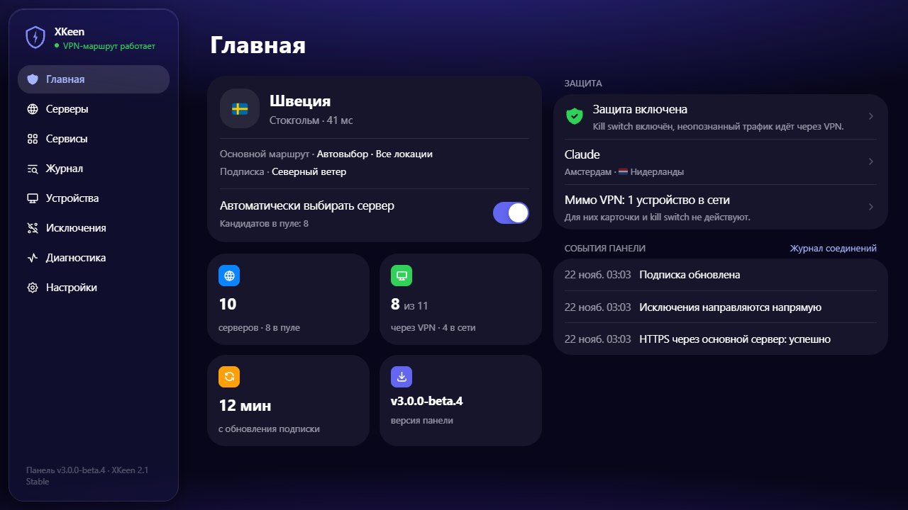
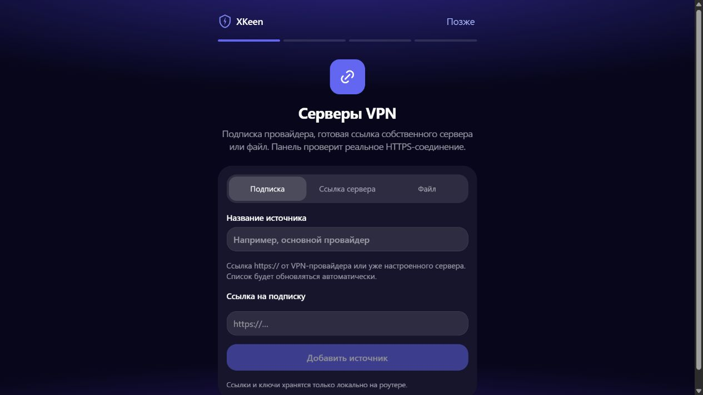
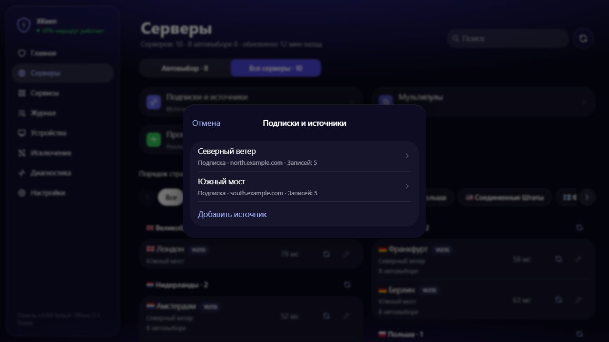
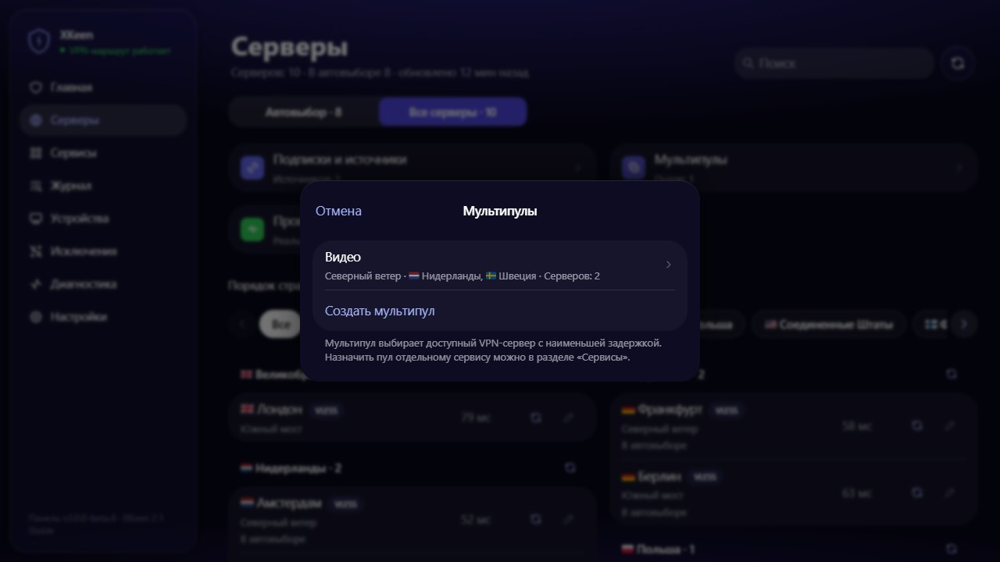
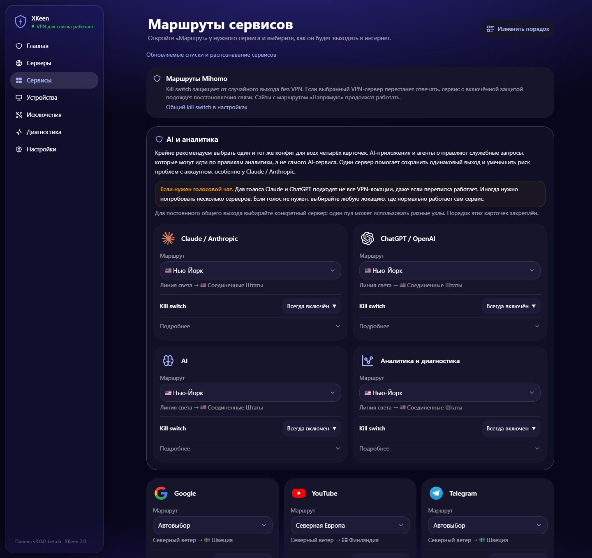
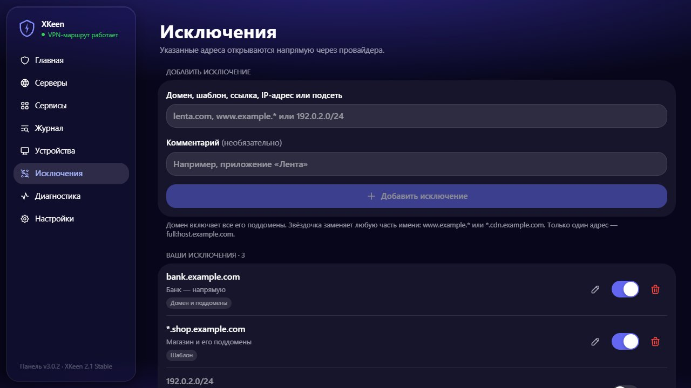
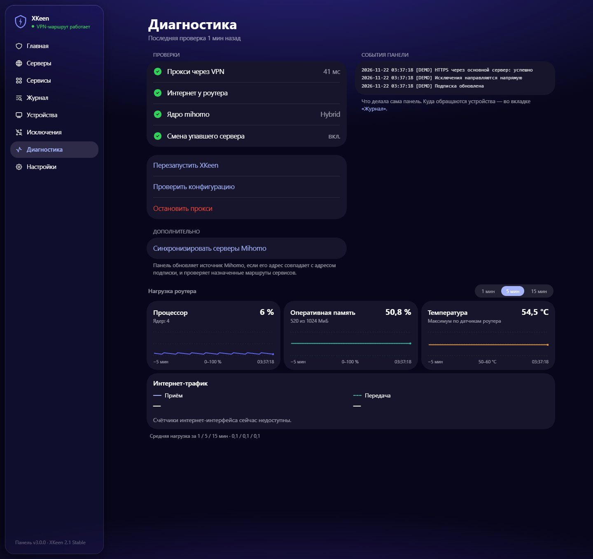
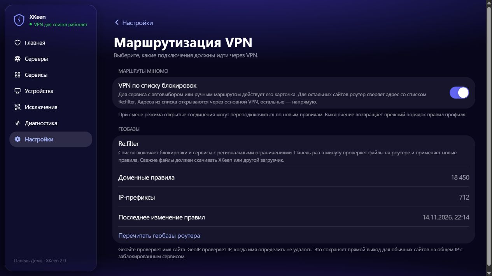
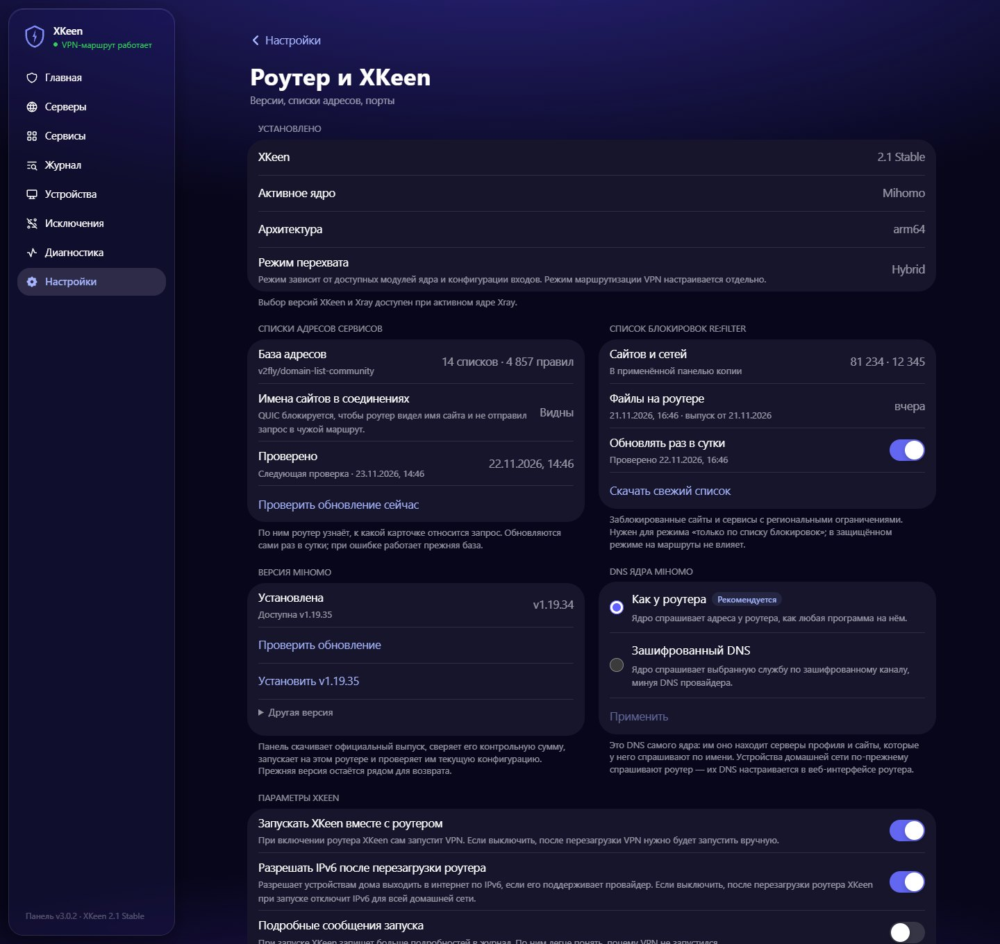
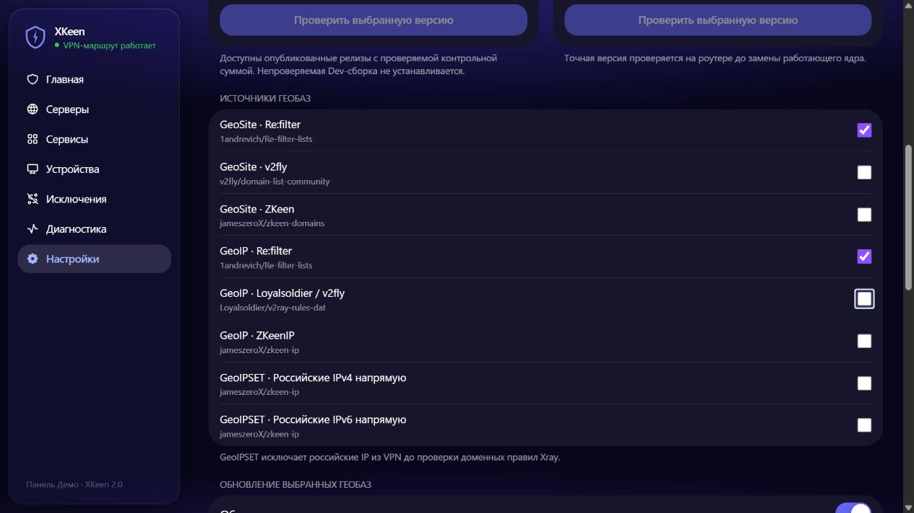

# XKeen Panel

Панель для домашнего роутера Keenetic или Netcraze. Здесь можно выбрать, через какую страну откроется YouTube, закрепить сервер за Claude, оставить Steam напрямую и посмотреть, каким маршрутом ушло соединение с телефона. Управлять панелью можно из браузера на компьютере или телефоне.

[Скачать панель и навык установки · v3.0.0-beta.5](https://github.com/Sgadmer/xkeen-panel/releases/tag/v3.0.0-beta.5) · [Установка с нуля](docs/installation.md) · [Перенос действующего VPN](docs/migration.md)



## Что где находится

| Хочу… | Куда перейти |
| --- | --- |
| Установить панель и подключить первый сервер | [Установка и первый вход](#установка-и-первый-вход) · [Мастер настройки](#мастер-настройки) |
| Узнать, работает ли VPN и кто выбрал текущий сервер | [Главная](#главная) |
| Добавить подписку, сравнить серверы или собрать свой пул | [Серверы и подписки](#серверы-и-подписки) · [Мультипулы](#как-собрать-свой-мультипул) |
| Назначить VPN одному приложению и защитить его при обрыве | [Сервисы](#сервисы) · [Kill switch](#что-делает-kill-switch) |
| Оставить телевизор напрямую или переименовать телефон | [Устройства](#устройства) |
| Открывать отдельные сайты напрямую | [Исключения VPN](#исключения-vpn) · [Режим VPN и сервисы](#режим-vpn-и-сервисы) |
| Проверить нагрузку роутера и куда ушёл запрос | [Диагностика](#диагностика) · [Соединения по устройствам](#соединения-по-устройствам) |
| Изменить параметры XKeen, порты или обновление баз | [Настройки](#настройки) · [Компоненты и геобазы](#компоненты-и-геобазы) · [Порты и системные исключения](#порты-и-системные-исключения) |
| Входить с iPhone по Face ID или получать уведомления | [Вход с ПК и телефона](#вход-с-пк-и-телефона-https-и-face-id) · [Уведомления](#уведомления) |
| Обновить панель или вернуть предыдущую версию | [Обновление и восстановление](#обновление-панели-и-восстановление) |

Руководство описывает **v3.0.0-beta.5**. Скриншоты сняты в **v3.0.0-beta.4** с вымышленными подписками, устройствами и адресами. Кнопки проверки пинга отдельного сервера, страны и автопула добавлены в beta.5. Набор кнопок зависит от ядра — программы, через которую роутер пропускает соединения. Название своего ядра можно посмотреть в **Настройки → Сведения**.

## Установка и первый вход

1. На компьютере в домашней сети скачайте и распакуйте архив навыка для **v3.0.0-beta.5**. Внутри будет папка `xkeen-router-install` с файлом `SKILL.md` и подпапкой `references`. Сохраните их вместе. Аккаунт GitHub для скачивания не нужен. [Скачать xkeen-router-install.zip](https://github.com/Sgadmer/xkeen-panel/releases/download/v3.0.0-beta.5/xkeen-router-install.zip)
2. Откройте распакованную папку в локальном агенте с доступом к браузеру и терминалу. Напишите **«Прочитай SKILL.md и помоги установить XKeen и панель на мой роутер. Хочу выбирать VPN отдельно для каждого сервиса»**. Подготовьте ссылку на подписку или готовую ссылку подключения к своему серверу. Пароли и одноразовые коды вводите локально.
3. Агент проверит модель, прошивку, свободное место, Entware и предыдущие установки. Если VPN на роутере уже работает, вы увидите, какие настройки удастся перенести и как вернуть прежнюю панель. Перед переключением агент сохранит резервную копию. Две работающие панели не должны одновременно менять правила одного роутера. Если провайдер привязал подписку к устройству по HWID, при переносе нужно сохранить его прежний идентификатор. [Перенос настроек и восстановление](docs/migration.md)
4. После установки агент покажет адрес именно вашей панели и проверит на подключённом устройстве доступ через VPN и прямой выход. Сохраните адрес в закладки. Чтобы открыть панель с телефона, подключитесь к тому же Wi-Fi и отсканируйте QR-код в **Настройки → Вход с ПК и телефона**.

**Для самостоятельной установки** скачайте исходники и файл контрольных сумм из одного выпуска. В инструкции описаны проверка роутера, резервная копия, подготовка комплекта на компьютере и запуск установщика на роутере. Готовые сборки выпускаются для ARM64 и MIPS little-endian. Совместимость зависит также от модели и прошивки. [Файлы релиза v3.0.0-beta.5](https://github.com/Sgadmer/xkeen-panel/releases/tag/v3.0.0-beta.5) · [Пошаговая установка](docs/installation.md)

Чистая установка по этой инструкции готовит XKeen 2.1 с Xray. Для карточек сервисов и журнала соединений нужен работающий Mihomo. Если он уже настроен, агент проверит возможность установить только панель. Для режима `--panel-only` установщик также требует установленные XKeen и Xray.

При первой настройке создайте отдельные логин и пароль панели (от 8 символов). Отсканируйте QR-код **в приложении для одноразовых кодов** и введите сгенерированный код в панель. Этот QR-код содержит секрет входа. Другой QR-код, который позже появится в разделе **Вход с ПК и телефона**, содержит адрес панели и открывается обычной камерой.

### Мастер настройки

**Настройки → Мастер настройки** можно открыть повторно. Мастер проверит текущее состояние и покажет шаг, с которого стоит продолжить. Если XKeen ещё отсутствует, он предложит инструкцию по установке и кнопку **Проверить снова**.

1. В **Серверы VPN** добавьте подписку, готовую ссылку сервера или файл. Если серверы уже подключены, можно продолжить с ними.
2. В **Режим VPN** выберите правила для вашего ядра.
3. В **Устройства** выберите, чьи подключения должен обрабатывать VPN. Если на роутере нет политики доступа `xkeen`, кнопка **Создать политику** появится при доступном интерфейсе управления Keenetic.
4. На шаге **Запуск** нажмите **Запустить**. Мастер запускает XKeen, включает автозапуск и контроль рабочего сервера, затем проверяет соединение через VPN. После подтверждения связи нажмите **Открыть панель**. Если связь не подтверждается, перейдите в **Диагностика**. Кнопка **Позже** позволяет вернуться к панели до окончания настройки установленного XKeen.



## Главная

Верхняя карточка показывает страну, название текущего сервера и задержку. Строкой ниже указано, как он выбран: вручную, из автопула, автоматической заменой или по профилю провайдера. На снимке в начале руководства основной маршрут для Re:filter использует подписку «Северный ветер». Из восьми кандидатов роутер выбрал Стокгольм. У сервиса со своим сервером в этот момент может быть другая локация.

- **Автоматически выбирать сервер** разрешает роутеру выбирать участника пула. Выключение закрепляет текущего участника, когда роутер уже сообщил его имя.
- Под карточкой есть быстрые переходы к серверам, устройствам, подписке и обновлению панели. «3 из 4 через VPN» означает, что для трёх устройств действуют правила VPN. Среди запросов этих устройств могут быть и прямые подключения.
- В **Событиях** видны последние изменения. Если вверху появилось **Проверяю**, **Нет интернета** или **Проверка маршрута недоступна**, откройте **Диагностику**. Там раздельно показаны доступ в интернет у самого роутера и результат проверки VPN.

## Серверы и подписки

У подписки может быть десяток серверов в разных странах. На вкладке **Все серверы** вы видите, что прислал провайдер. На вкладке **Автовыбор** — из каких серверов разрешено выбирать роутеру и какой из них сейчас используется. Галочка отмечает текущий сервер. Это **основной маршрут** для трафика, которому нужен VPN. У отдельных сервисов может быть свой выбор.


### Как добавить подписку, сервер или файл

Откройте **Серверы → Подписки и источники → Добавить источник**. Дайте источнику понятное имя. Можно добавить несколько подписок и использовать серверы из них одновременно. Это имя вы увидите рядом с сервером и при выборе маршрута для сервиса.

| Что у вас есть | Что выбрать в панели |
| --- | --- |
| Ссылка на список серверов от провайдера | **Подписка**. Вставьте ссылку. Когда провайдер изменит список, панель сможет скачать новые данные. |
| Ссылка на одно готовое подключение, например VLESS, VMess, Trojan или Shadowsocks | **Ссылка сервера**. Скопируйте ссылку подключения целиком из настроенного клиента. Одного IP-адреса сервера недостаточно. |
| Файл, который прислал провайдер | **Файл**. Выберите текстовый файл со ссылками или поддерживаемую конфигурацию JSON/YAML размером до 4 МиБ. Файлы и одиночные ссылки не обновляются по расписанию. |



Откройте добавленный источник, чтобы переименовать его, посмотреть число импортированных серверов и сборных профилей, обновить подписку или удалить её. Если часть записей использует неподдерживаемые функции, панель покажет пропуски. Чтобы обновить все подписки сразу, нажмите круглую стрелку вверху экрана **Серверы**. Чтобы изменить расписание, откройте **Серверы → Автовыбор → Автоматика → Обновлять подписки**. Доступны интервалы от 15 минут до суток и вариант **Не обновлять**.

Перед удалением источника посмотрите, какие сервисы и пулы используют его серверы. Его записи исчезнут из каталога и мультипулов. Для источника, который использует профиль Mihomo, панель отдельно предупредит об отключении связанных провайдеров. Если удаляемый узел закреплён в такой группе, сперва выберите другой.

### Как выбрать страну или один конкретный сервер

- **Нужен конкретный сервер.** Откройте **Серверы → Все серверы**, найдите локацию по названию, стране или имени подписки и нажмите на строку сервера. Вариант подходит, например, если сайт узнаёт ваш привычный адрес. Сервер останется выбранным вручную. Если включена **Автоматика → Менять упавший сервер**, при отказе общего сервера панель сможет подобрать проверенную замену из той же страны. Закреплённые маршруты карточек Mihomo и составные профили сохраняют свой выбор.
- **Нужна страна, а сервер внутри неё может меняться.** На Mihomo откройте **Автовыбор → Пул автовыбора** и выберите страну. В пуле собраны серверы с этой меткой из всех подписок. Число рядом со страной показывает состав её собственного пула. Страна с нулём подходящих серверов недоступна для выбора.
- **Страна не важна.** Выберите **Все локации**. Если выключить **Автоматически выбирать сервер**, панель закрепит текущий сервер. Вернуться к автоматическому выбору можно тем же переключателем.
- **Нужен готовый режим подписки.** Ниже пула находятся **Режимы провайдера**. Если подписка содержит совместимый составной профиль, например «Самый быстрый» или «Автообход», его можно выбрать целиком. Какие серверы входят в этот профиль и как распределяется трафик, определил провайдер. Исключения стран, заданные для автовыбора панели, не переписывают его внутренние правила.

На вкладке **Все серверы** порядок групп по умолчанию алфавитный. В поле **Порядок стран** можно выбрать обратный порядок или сортировку по наименьшему пингу в каждой стране. Если порядок должен оставаться постоянным после проверки, оставьте алфавитную сортировку. Группа **Без страны** идёт последней среди стран.


### Сколько серверов попадёт в пул и когда сменится локация

**Лимит пула «Все локации»** находится в **Серверы → Автовыбор**. Он относится только к этому пулу Mihomo. По умолчанию в него входит до **8** разных серверов. Укажите целое число от **1 до 256** и нажмите **Сохранить**. Если подходят 20 серверов и вы поставили лимит 200, в пул войдут все 20. Число в поле — максимум, который вы разрешаете использовать.

Панель собирает подходящие серверы всех подписок, убирает дубли, исключённые страны, сборные профили и узлы с неудачной HTTPS-проверкой. Сначала в пул попадают серверы с наименьшей известной задержкой. Если ещё есть место, могут попасть и непроверенные. Надпись **«В пуле 8 из 20 подходящих»** показывает число реально отобранных серверов и общее число кандидатов.

**Проверить HTTPS** открывает тестовое HTTPS-соединение через серверы с самого роутера. На время проверки кнопка занята. У каждой строки результат появляется отдельно. Проверка продолжается при переходе в другой раздел. Значение в миллисекундах показывает время отклика при конкретной проверке. Для скорости скачивания нужен другой замер.

Кнопка обновления рядом с сервером проверяет только этот сервер. Такая же кнопка в заголовке страны проверяет все серверы этой страны, а в заголовке автопула — его текущий состав. Во время проверки крутится значок у выбранных серверов, затем появляется результат. До её завершения остальные кнопки проверки заняты. Длинную строку стран можно прокрутить полосой прокрутки, кнопками по краям или свайпом на телефоне.

Галочка не обязана стоять у наименьшего числа в таблице. Таблица показывает результаты проверки каталога, а автоматический пул ведёт собственные фоновые замеры и использует их при выборе сервера для новых соединений. Германия может оставаться выбранной, даже если при последней ручной проверке быстрее ответила Швеция. Для готовых режимов провайдера момент переключения зависит от правил этого профиля.

### Как исключить страну

Откройте **Серверы → Автовыбор → Автоматика → Не выбирать страны**. Список формируется из стран в ваших подписках. Отмеченные страны пропускаются при автовыборе и автоматической замене. Если конкретный сервер из такой страны нужен для одного сервиса, его можно назначить вручную. В выборе маршрута он помечен **Только вручную**.

Панель читает метку страны из названия локации. При нескольких флагах берётся первый. Если флага нет, панель ищет узнаваемое название или код страны. Например, сервер с названием `🇷🇺 → 🇩🇪` попадёт в группу России и при исключённой России выйдет из автовыбора. Если провайдер обозначил сервер как «Сомали», российский адрес подключения сам по себе не исключит его из пула. Чтобы исправить метку, нажмите карандаш рядом с нужным сервером во **Всех серверах**. Название из подписки сохранится.

### Как собрать свой мультипул

Допустим, для YouTube вам подходят все нидерландские серверы одной подписки и один шведский сервер другой. На Mihomo откройте **Серверы → Мультипулы → Создать мультипул**, дайте ему имя и выберите **По условиям и вручную**. В условиях укажите первую подписку и Нидерланды. В списке конфигов найдите шведский сервер по имени или источнику, отметьте его и нажмите **Сохранить мультипул**. Исключения стран действуют и для отмеченных вручную конфигов внутри пула.



Если нужны только фиксированные серверы, выберите **Отдельные конфиги**. Если нужны все подходящие серверы выбранных стран, выберите **По странам и подпискам**. Пункт **Все, включая новые подписки** включает в отбор и те источники, которые вы добавите позже. Так можно собрать, например, общий пул Нидерландов и Германии без ручного добавления каждого нового сервера.

Один мультипул вмещает до 256 разных серверов. После сохранения он появится в **Пуле автовыбора**, в конце списка **Все серверы** и в выборе маршрута в **Сервисах**. Можно назначить его основным маршрутом либо только одному сервису. Если после изменения подписки или исключений состав пула опустеет, проверьте его счётчик и назначьте подходящие серверы. При включённом kill switch пустой пул блокирует назначенный ему трафик. Если для этого маршрута разрешён запасной прямой выход, соединение может пойти через домашнего провайдера. Увеличение лимита **Всех локаций** не добавит участников в отдельный мультипул.

### Если отдельный сайт открывается только через часть серверов Xray

В режиме пула Xray откройте **Серверы → Автовыбор → Сайты → Добавить сайт**. Введите домен или несколько доменов через запятую. Поддомены учитываются автоматически. В поле **Адрес проверки** можно указать конкретную страницу, например страницу входа, которая не работает через часть серверов. Если оставить поле пустым, панель проверит главную страницу первого домена.

Панель попробует открыть эту страницу через участников пула и покажет, сколько из них справилось. При наличии успешных проверок сайт получит только прошедшие серверы. Если проверку не прошёл ни один, сайт продолжит использовать весь пул. Повторная проверка запускается при смене пула, раз в 12 часов или кнопкой **Проверить снова**. На Mihomo для готовых сервисов используйте отдельные карточки ниже.

## Сервисы

Панель умеет ежедневно обновлять списки адресов сервисов, точнее обрабатывать Discord и показывать реальные события защиты соединений. Включение и границы распознавания описаны в [инструкции по обновляемым правилам](docs/service-rules.md).

Здесь определяется, через какой VPN должен работать конкретный сервис. Например, вы можете оставить основной маршрут автоматическим, назначить Claude один сервер в США, YouTube — пул Нидерландов, а Steam открывать напрямую. Назначение в карточке применяется к распознанным запросам этого сервиса от устройств, которые участвуют в правилах VPN.



### Готовые карточки

| Для чего | Какие сервисы есть в панели |
| --- | --- |
| ИИ | Claude / Anthropic, ChatGPT / OpenAI и общая карточка AI для других сервисов, в том числе Perplexity, Gemini и Mistral |
| Поиск, разработка и покупки | Google, GitHub, Amazon |
| Видео и музыка | YouTube, Spotify, Twitch, Netflix, Disney+, Prime Video, Hulu, HBO |
| Соцсети и мессенджеры | Telegram, Discord, Instagram, WhatsApp, Facebook, X (Twitter), LINE |
| Игры | Steam, PlayStation, Xbox |

У YouTube и Google отдельные назначения, как и у Prime Video и Amazon. Можно выбрать одну подписку для видео, а другую — для остальных сервисов Google.

### Как назначить сервер или пул

1. Откройте **Сервисы**, найдите карточку и нажмите **Маршрут**. Для YouTube, ChatGPT и Claude предусмотрены отдельные карточки.
2. Выберите подходящий вариант из таблицы ниже. Готовые режимы и отдельные серверы сгруппированы по имени подписки. Название и значки, которые вы дали подписке, помогут отличить одинаковые локации.
3. Посмотрите строку под полем маршрута. Там появится текущая локация и, если известно, имя подписки, например **Северный ветер → Швеция**. При смене сервера в пуле подпись обновится. Если данных о локации пока нет, в карточке появится «Локация неизвестна». Посмотреть, какое правило выбрал роутер для конкретного подключения, можно в **Диагностике**.


| Выбор в карточке Mihomo | Как пойдёт трафик |
| --- | --- |
| **Автовыбор** | Распознанные запросы сервиса идут через VPN-пул **Все локации**. Роутер выбирает подходящий сервер. |
| **Пулы стран** или **Мультипулы** | Роутер выбирает только среди участников назначенного пула. Подходит, если нужна определённая страна или свой набор проверенных серверов. |
| Отдельный сервер в группе подписки | Распознанные запросы идут на закреплённый сервер. Выбор основного пула в «Серверах» можно менять независимо. |
| **Режим провайдера** | Применяется совместимый составной профиль подписки. Поведение определяется правилами самого профиля. |
| **Напрямую** | Сервис работает через обычное соединение интернет-провайдера. Для Steam это исходная настройка. У Claude доступны только VPN-маршруты. |

**Изменить порядок** позволяет перетащить карточки за ручку или передвинуть стрелками. Порядок сохраняется в этом браузере. После обновления старой установки может появиться предложение **Автовыбор для сервисов**. Нажатие **Применить** переводит карточки с прежних правил роутера на исходные маршруты и сохраняет сделанные вручную назначения.

### Что делает Kill switch

Например, вы закрепили сервер за ChatGPT. Если сервер перестанет отвечать, при включённой защите запросы к распознанным адресам ChatGPT будут ждать рабочего VPN. Магазин или игра, для которых выбрано **Напрямую**, продолжат открываться через обычное соединение.

В **Настройки → Защита VPN** находится общий переключатель Mihomo. По умолчанию он включён. В каждой карточке можно выбрать один из трёх режимов.

| Значение в карточке | Если у сервиса перестал работать VPN |
| --- | --- |
| **Всегда включён** | Запасной прямой выход закрыт даже при выключенном общем переключателе. Это исходное значение карточек. |
| **Как в настройках** | Действует общий переключатель. Если его выключить, сервису будет разрешён запасной выход напрямую. |
| **Всегда выключен** | Сервису разрешён выход напрямую при отказе VPN, даже если общий переключатель включён. |

Эти правила действуют, пока Mihomo обрабатывает трафик. В карточке Claude отдельно виден статус фильтра роутера для опубликованных сетей Anthropic API. Этот фильтр блокирует прямые соединения к данным диапазонам независимо от Mihomo. Прочие домены и сторонние запросы приложения имеют отдельные правила. [Подробнее о защите при обрыве VPN](docs/selective-guard.md)

### Зачем в карточке логин и пароль прокси

При обычном входе в ChatGPT или Claude по домашнему Wi-Fi **вводить эти данные не нужно**. Роутер сам применяет маршрут к известным адресам сервиса. Список таких адресов доступен в **Подробнее → Домены сервиса**.

Иногда приложение обращается также к сторонним адресам, например загружает файлы. Если у приложения есть настройка **HTTP-прокси**, в карточке можно открыть **Подробнее → Прокси для приложения → Настроить прокси вручную** и ввести выданные адрес, логин и пароль **в самом приложении**. Эти данные дают доступ к прокси на роутере. По выбранному маршруту пойдут запросы, которые приложение передаст этому прокси. Если приложение предлагает запасной прямой выход при отказе прокси, отключите этот запасной выход. Пароль от учётной записи ChatGPT или Claude для этой настройки не нужен.

## Устройства

Выберите, для каких телефонов, компьютеров и телевизоров роутер должен применять правила VPN. Выключите переключатель у телевизора, чтобы он ходил напрямую. Оставьте переключатель у телефона включённым, чтобы на нём работали назначения из карточек сервисов.


- **Новые устройства через VPN** задаёт выбор для тех, кто впервые подключится к домашней сети. Он действует и для устройств с политикой Keenetic «как вся сеть».
- **Карандаш рядом с именем** позволяет переименовать зарегистрированное устройство. Если роутер ещё не запомнил его, введите имя и нажмите **Зарегистрировать**. Это имя будет видно и в штатном списке роутера.
- **Удалить регистрацию** удаляет сохранённое имя. Индивидуальные правила VPN и пробросы портов могут сброситься. Подключённое устройство может тут же появиться снова.
- **Соединения** у активного устройства открывает диагностику с уже выбранным телефоном или компьютером. Это удобно, если имя сайта заранее неизвестно.

## Исключения VPN

Откройте **Исключения** в главном меню, чтобы добавить адрес для прямого подключения. Введите адрес, при желании добавьте комментарий и нажмите **Добавить исключение**. Для всего сайта с поддоменами укажите `example.org`, для одного точного имени — `full:shop.example.org`. Можно указать IP или подсеть, например `192.0.2.0/24`. Если вставить ссылку на страницу, панель возьмёт из неё имя сайта. Корзина справа удаляет запись. Исключения сохраняются при смене сервера и обновлении подписки. Mihomo применяет исключения без перезапуска ядра. Правила Claude имеют приоритет даже перед этими исключениями. Для остальных сервисов ручное прямое исключение имеет приоритет перед карточкой, а карточка — перед списком Re:filter.



## Диагностика

### Нагрузка роутера и трафик

Выберите интервал **1, 5 или 15 минут**. Для процессора показана загрузка в процентах, для памяти — доля и объём, для температуры — самый горячий доступный датчик. График **Интернет-трафик** показывает приём и передачу через интернет-интерфейс роутера. Скорость указана в битах в секунду, объём за время наблюдения — в байтах. Здесь учитывается и прямой трафик, и VPN.



### Соединения по устройствам

1. Откройте **Диагностика → Соединения по устройствам**. Выберите устройство и при необходимости сервис. Затем снова откройте сайт или запустите видео на этом устройстве.
2. Найдите новое соединение и нажмите **Пауза**, пока оно видно. Список Mihomo обновляется раз в три секунды. Пауза фиксирует снимок на экране, а интернет у устройства продолжает работать.
3. Прочитайте маршрут слева направо. В первой строке примера запрос тестового планшета распознан как **YouTube**, назначен мультипулу **Северная Европа** и ушёл через **Хельсинки**. Ниже видны сработавшее правило и подписка **Северный ветер**.


Через **Поиск** можно найти домен, IP назначения, имя сервера, подписку или правило. Ввод текста сбрасывает выбор сервиса, но сохраняет фильтр устройства. Выбор сервиса очищает текст поиска. Если используется пул Xray, пунктиром отмечен его текущий сервер. Он мог смениться после открытия конкретного соединения. В HTTPS-соединении роутер может видеть имя сайта и порт, а путь страницы после домена остаётся зашифрованным.

### Проверки и журнал

- **Проверки** показывают, работает ли ядро, есть ли интернет у роутера, прошла ли проверка VPN и включена ли замена упавшего сервера. При Re:filter отдельная строка показывает маршрут для остального трафика.
- **Проверить конфигурацию** помогает найти ошибку в настройках ядра. Рядом можно запустить остановленный прокси, остановить его или перезапустить XKeen. Остановка и перезапуск требуют повторного нажатия и могут прервать текущие подключения.
- **Дополнительно** позволяет синхронизировать серверы Mihomo и перепроверить назначенные маршруты. При Xray здесь доступны сборка пула из подписки или синхронизация существующего пула. Перед первой сборкой панель предупреждает о перезаписи маршрутизации и сохраняет копии конфигурации.
- **Журнал** содержит сообщения самой панели. Если сервер исчез после обновления или проверка завершилась ошибкой, смотрите записи в момент действия. Список соединений выше отвечает на другой вопрос — куда в этот момент шёл трафик устройства.

## Настройки

Откройте **Настройки** в главном меню. В блоке **Сведения** указаны версия панели, версия XKeen и активное ядро. XKeen на роутере перехватывает подключения выбранных устройств. Ядро, **Mihomo** или **Xray**, применяет к ним правила. Название ядра подскажет, какими инструкциями ниже воспользоваться. **Выйти** завершает сеанс в браузере. VPN на роутере продолжает работать.


### Режим VPN и сервисы

**С Mihomo** откройте **Настройки → Режим VPN и сервисы → VPN по списку блокировок**. Допустим, для YouTube вы выбрали VPN в его карточке. Для распознанных запросов YouTube применяется этот выбор. Если у другого сайта нет отдельного назначения или исключения, роутер ищет его имя в списке Re:filter. Совпадение отправляет запрос через основной VPN. Сайт с известным именем вне списка открывается напрямую. Когда виден только IP-адрес, роутер сверяет его с сетями Re:filter. В списке есть и сервисы с региональными ограничениями. Выключение режима возвращает прежние правила профиля. При смене режима открытые соединения могут переподключиться.

Ниже видны количество доменных правил, количество сетей и время последнего изменения правил. **Перечитать геобазы роутера** сразу применяет уже загруженные файлы. При включённом режиме панель также проверяет изменения файлов раз в минуту. **Если свежие файлы Re:filter скачивает XKeen, оставьте его штатное расписание включённым.** После отключения расписания сохранённые правила продолжат работать. Для поступления новых версий понадобится другой загрузчик.



**С Xray** в том же разделе доступны три варианта.

| Режим | Что произойдёт |
| --- | --- |
| VPN для выбранных сервисов | Отметьте сервисы и при необходимости впишите дополнительные домены, IP или подсети по одному на строке. Остальной трафик идёт напрямую. |
| VPN для всего, кроме исключений | Подключения выбранных устройств идут через VPN. Локальная сеть и прямые исключения доступны своим обычным путём. |
| Сохранить текущую / провайдерскую политику | Применяются исходные правила установки или составного профиля провайдера. Чтобы перейти к ручному режиму при активном составном профиле, сначала выберите обычный сервер в разделе «Серверы». |

Для применения в Xray отметьте подтверждение и нажмите **Сохранить режим**. VPN кратко перезапустится. Устройства, порты и сети, которые сам XKeen пропускает напрямую, до правил Xray не доходят.


### Компоненты и геобазы

В **Настройки → Компоненты и геобазы** откройте блок **Установлено**. Здесь видны ядро, версия XKeen, архитектура процессора и режим перехвата. Например, «Hybrid» описывает, как роутер передаёт подключения в ядро. Какие сайты пойдут через VPN, задаёт раздел **Режим VPN и сервисы**.



**С Mihomo** здесь есть переход к состоянию Re:filter и общие параметры XKeen. **С Xray** на поддерживаемой установке XKeen 2.x для ARM64 или MIPS little-endian можно также менять версии XKeen и Xray и обновлять выбранные геобазы. В блоке нужного компонента выберите канал, нажмите **Загрузить список версий** и выберите выпуск либо впишите его точный номер. Нажмите **Проверить выбранную версию**. Панель покажет файлы, их контрольные суммы, необходимое место и предупреждения. Установка начинается после **Применить с резервной копией**. Ход работы и результат видны в блоке **Последняя операция**.

Геобазы помогают правилам Xray узнать набор сайтов или сетей. В блоке **Источники геобаз** можно выбрать восемь источников.

| Тип | Доступные источники | Для чего |
| --- | --- | --- |
| GeoSite | Re:filter, v2fly, ZKeen | Списки имён сайтов для доменных правил. |
| GeoIP | Re:filter, Loyalsoldier / v2fly, ZKeenIP | Списки IP-сетей для правил по адресу назначения. |
| GeoIPSET | Российские IPv4 напрямую, российские IPv6 напрямую | XKeen направляет совпавшие адреса напрямую ещё до Xray. Доменное правило Xray уже не сможет направить такое подключение в VPN. |



Нажмите **Сохранить источники и расписание**, затем **Проверить обновление геобаз** для первой загрузки. Сохранение выбора определяет, какие файлы обслуживает панель. Уже установленные другие базы остаются на роутере. Для регулярных загрузок включите **Обновлять автоматически** и задайте день, час и минуту по часам роутера. Доступны ежедневный запуск и конкретный день недели. Если включено штатное расписание XKeen, панель попросит сначала отключить его, чтобы два обновления не записывали одни и те же файлы.

### Параметры XKeen

Внизу экрана **Компоненты и геобазы** возле каждого доступного переключателя есть пояснение. Нажмите переключатель, ознакомьтесь с тем, что изменится в вашей сети, и подтвердите действие. Панель проверяет возможность изменения и место для резервной копии. Доступность зависит от ядра и установленной версии XKeen.

| Параметр | Когда он пригодится |
| --- | --- |
| Запускать XKeen вместе с роутером | Включите, если VPN должен сам подниматься после перезагрузки. С выключенным автозапуском потребуется запустить XKeen вручную. |
| Поддержка IPv6 | Влияет на всю домашнюю сеть. В интерфейсе Mihomo пункт называется «Разрешать IPv6 после перезагрузки роутера» и задаёт поведение при следующем запуске XKeen после перезагрузки. Для доступа по IPv6 нужна поддержка провайдера. |
| Подробные сообщения запуска | Включите для диагностики, если XKeen не запускается. В журнале появятся подробности запуска. |
| Резервная копия при обновлении XKeen | Позволяет самому XKeen сохранить свои файлы перед обновлением. Панель также создаёт собственные копии перед поддерживаемыми изменениями. |
| Штатное расписание геобаз XKeen | Отключает загрузки по прежнему расписанию. Этот элемент позволяет только отключить расписание. Особенно важно проверить, кто будет скачивать новые базы Re:filter. |
| Направлять DNS через Xray | Доступно с Xray. Передаёт в ядро обычные запросы, которыми устройство узнаёт IP сайта. Шифрование этих запросов задаётся отдельно. |
| Направлять соединения программ роутера в Xray | Доступно с Xray. Охватывает соединения программ самого роутера, включая Entware. Дальше к ним применяются правила Xray. |

### Порты и системные исключения

В **Настройки → Порты и системные исключения** выбирают, какие соединения вообще попадут в VPN-ядро. Это нужно, например, если требуется исключить целую сеть независимо от приложений.

| Поле | Что вводить и когда действует |
| --- | --- |
| Порты проксирования | По одному порту или диапазону на строку, например `443` или `596:599`. Пустой список разрешает обработку всех портов с учётом исключений. Текст после `#` служит комментарием. |
| Порты-исключения | Порты, которые пойдут в обход ядра. Если заполнен список портов проксирования, у него приоритет. |
| IP-исключения | Адреса с маской. Например, `192.0.2.10/32` для одного адреса или `192.0.2.0/24` для подсети. |
| Загрузки с GitHub | При необходимости укажите адрес прокси, через который сам XKeen скачивает обновления, если GitHub недоступен напрямую. |

Нажмите **Изменить** у нужного списка и **Сохранить** после правки. Чтобы новые списки портов и IP начали действовать, откройте **Диагностика → Перезапустить XKeen**. Текущие VPN-соединения могут кратко прерваться.


### Вход с ПК и телефона, HTTPS и Face ID

**Если вам хватает входа с паролем и одноразовым кодом, домашний HTTPS можно пропустить.** HTTPS понадобится для Face ID и системных уведомлений.


1. Откройте **Настройки → Вход с ПК и телефона → Подготовить адрес для iPhone**. На совместимом роутере панель предложит использовать существующее имя или зарегистрировать новое в CrazeDNS.
2. Нажмите **Проверить адрес и параметры** и прочитайте план. Если у штатного интерфейса роутера разрешён вход из интернета, форма отдельно покажет изменение этого доступа. После подтверждения роутер сам запросит и будет продлевать сертификат. Safari принимает его без установки профиля.
3. Когда появится **HTTPS-адрес готов**, подключите iPhone к домашнему Wi-Fi. Откройте готовую ссылку в Safari или наведите камеру на QR-код панели. Войдите с паролем и одноразовым кодом.
4. Откройте **Настройки → Включить вход по Face ID**, сохраните ключ на iPhone и подтвердите действие. При следующих входах открывайте **тот же HTTPS-адрес** и нажимайте **Войти по Face ID**. Удалить зарегистрированный ключ можно в блоке **Вход по Face ID**.

На экране выше показан вымышленный адрес. Сканируйте QR-код в своей панели. Если помогает агент, попросите: **«Настрой домашний HTTPS через мою панель, объясни изменения удалённого доступа и покажи мой QR-код»**. Имя из публичного сертификата может появиться в открытых журналах сертификатов, поэтому мастер предлагает случайное имя. Ключ доступа сохраняет владелец iPhone. Для быстрого входа с компьютера добавьте ссылку в закладки, на iPhone выберите в Safari **Поделиться → На экран «Домой»**, на Android — пункт установки или добавления на главный экран в меню браузера. [Инструкция для агента](skills/xkeen-router-install/references/panel-https.md)

На компьютере разделы открываются из левого меню. На телефоне те же семь разделов вынесены в нижнюю строку. Кнопка **Диагн.** открывает графики и соединения, **Настр.** — параметры панели.


### Уведомления

Настройка действует для конкретного браузера и устройства. Зайдите в панель по HTTPS и откройте **Настройки → Уведомления**. Включите **Системные уведомления** и разрешите их в запросе браузера. На iPhone или iPad с iOS/iPadOS 16.4 и новее сначала добавьте HTTPS-панель на экран «Домой» через Safari и откройте её со значка.


Включите нужные события. **Смена сервера** сообщает о новом сервере общего маршрута, **Связь через VPN** — когда общий маршрут перестал отвечать или восстановился, **Обновление панели** — когда найден новый выпуск. Нажмите **Отправить проверочное уведомление**. С фоновой доставкой Web Push вкладку можно закрыть. Если браузер предложит **Уведомлять в открытой панели**, для получения событий вкладка должна оставаться открытой. Если доступ уже был запрещён, измените разрешение сайта в настройках браузера.

### Обновление панели и восстановление

**Настройки → Обновление панели** показывает установленную версию, репозиторий и канал. Для стабильной версии проверяются стабильные выпуски, для beta — также предварительные. Нажмите **Проверить сейчас**, затем **Что нового** и **Обновить до…**, если вам подходит выпуск. Панель перезапустится. Переключатель **Обновляться автоматически** разрешает установку ночью в указанное на экране время роутера. Сообщение **Обновление кода панели заблокировано** означает, что установку персональной сборки выполняют отдельно. Подписки серверов по-прежнему обновляются по своему расписанию.


| Что требуется вернуть | Где это сделать |
| --- | --- |
| Предыдущую версию панели | В **Настройки → Обновление панели** нажмите **Откатить на…**, если на роутере есть предыдущая версия, и подтвердите повторным нажатием. |
| Файлы компонента или изменённый параметр | В **Компоненты и геобазы → Резервные копии компонентов** выберите доступную копию по компоненту и дате. Нажмите **Восстановить**, затем **Подтвердить восстановление**. Для копии отдельного параметра вернётся его значение. При восстановлении компонентов VPN может кратко перезапуститься. Результат указан в **Последняя операция**. |
| Всю прежнюю установку после переноса | До начала переноса сохраните штатную резервную копию роутера и отдельную копию файлов Entware на компьютере. Для возврата пригодятся обе, включая данные старой панели и её службы. [Порядок миграции и восстановления](docs/migration.md) |

## Сборка и демонстрационный режим

Для локальной сборки используются Go 1.27.1, Node.js 24 и npm. Выполните в корне репозитория

```sh
cd frontend
npm ci
npm run build
cd ..
go test ./...
python3 -m unittest discover -s installer/tests -v
python3 scripts/check-public-source.py --tracked-only
go run . -demo
```

Демонстрационный режим открывает панель на этом компьютере по адресу `http://127.0.0.1:3300` с тестовыми данными. Рабочие подписки, пароли, HWID, настройки роутера, журналы и резервные копии в релиз не входят. [Проверки проекта](.github/workflows/verify.yml) · [Сборка релиза](.github/workflows/release.yml)

## Авторы

Исходную панель создал Dearonski. Этот форк сопровождает Sgadmer. В разработке панели, установщика, тестов и навыка помогает OpenAI Codex. Его участие указывается в соответствующих коммитах. История исходного проекта сохранена. К коду и зависимостям по-прежнему применяются условия их авторов. [Dearonski/xkeen-panel](https://github.com/Dearonski/xkeen-panel) · [Sgadmer](https://github.com/Sgadmer) · [OpenAI Codex](https://github.com/openai/codex)

Панель использует независимые проекты их авторов. [XKeen](https://github.com/jameszeroX/XKeen) · [Mihomo](https://github.com/MetaCubeX/mihomo) · [Xray-core](https://github.com/XTLS/Xray-core)
