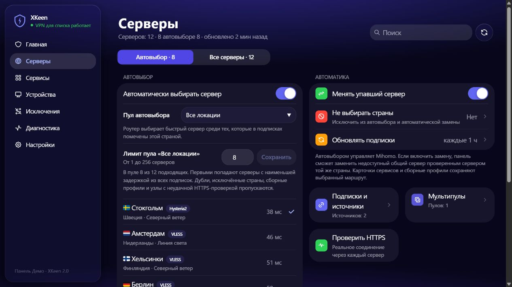
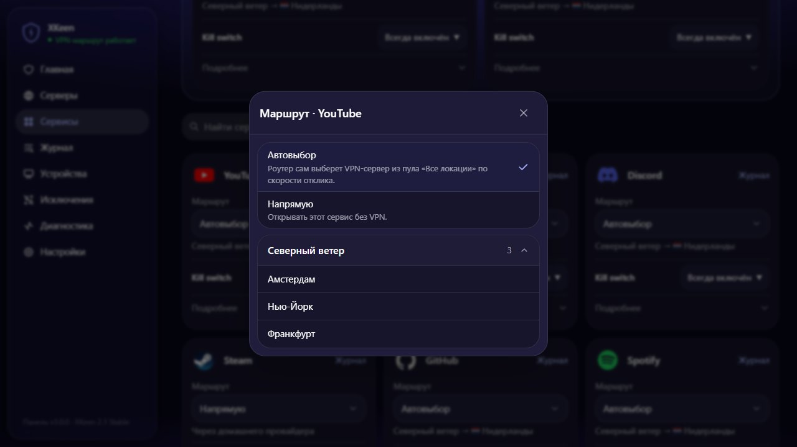
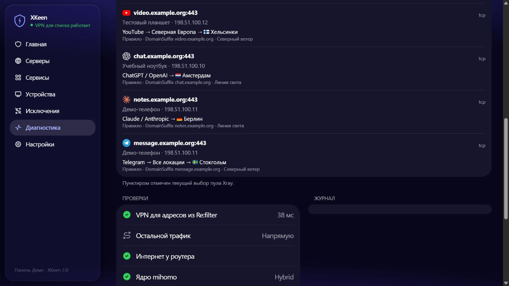

# XKeen Panel

Домашняя панель для роутеров Keenetic и Netcraze. Можно выбрать, через какую страну откроется YouTube, закрепить сервер за Claude и оставить Steam напрямую. На телефоне или компьютере достаточно подключиться к домашнему Wi-Fi и открыть панель в браузере.

Это русскоязычный форк панели Dearonski для роутеров с Entware и XKeen. Набор функций зависит от установленного ядра. Карточки сервисов и журнал соединений, показанные ниже, работают с Mihomo. [Исходная панель Dearonski](https://github.com/Dearonski/xkeen-panel) · [XKeen](https://github.com/jameszeroX/XKeen)


## Установка и первый вход

1. На компьютере в домашней сети скачайте и распакуйте архив навыка для **v3.0.0-beta.4**. Внутри будет папка `xkeen-router-install` с файлом `SKILL.md` и подпапкой `references`. Сохраните их вместе. Аккаунт GitHub для скачивания не нужен. [Скачать xkeen-router-install.zip](https://github.com/Sgadmer/xkeen-panel/releases/download/v3.0.0-beta.4/xkeen-router-install.zip)
2. Откройте распакованную папку в локальном агенте с доступом к браузеру и терминалу. Напишите **«Прочитай SKILL.md и помоги установить XKeen и панель на мой роутер. Хочу выбирать VPN отдельно для каждого сервиса»**. Подготовьте ссылку на подписку или готовую ссылку подключения к своему серверу. Пароли и одноразовые коды вводите локально.
3. Агент проверит модель, прошивку, свободное место, Entware и предыдущие установки. Если VPN на роутере уже работает, вы увидите, какие настройки удастся перенести и как вернуть прежнюю панель. Перед переключением агент сохранит резервную копию. Две работающие панели не должны одновременно менять правила одного роутера. Если провайдер привязал подписку к устройству по HWID, при переносе нужно сохранить его прежний идентификатор. [Перенос настроек и восстановление](docs/migration.md)
4. После установки агент покажет адрес именно вашей панели и проверит на подключённом устройстве доступ через VPN и прямой выход. Сохраните адрес в закладки. Чтобы открыть панель с телефона, подключитесь к тому же Wi-Fi и отсканируйте QR-код в **Настройки → Вход с ПК и телефона**.

**Для самостоятельной установки** скачайте исходники и файл контрольных сумм из одного выпуска. В инструкции описаны проверка роутера, резервная копия, подготовка комплекта на компьютере и запуск установщика на роутере. Готовые сборки выпускаются для ARM64 и MIPS little-endian. Совместимость зависит также от модели и прошивки. [Файлы релиза v3.0.0-beta.4](https://github.com/Sgadmer/xkeen-panel/releases/tag/v3.0.0-beta.4) · [Пошаговая установка](docs/installation.md)

Чистая установка по этой инструкции готовит XKeen 2.1 с Xray. Для карточек сервисов и журнала соединений нужен работающий Mihomo. Если он уже настроен, агент проверит возможность установить только панель. Для режима `--panel-only` установщик также требует установленные XKeen и Xray.

## Серверы и подписки

Откройте **Серверы → Подписки и источники**. Добавьте ссылку и дайте подписке понятное имя. Так же можно добавить вторую подписку, ссылку на отдельный сервер или поддерживаемый файл. У каждого источника своё имя, и его можно удалить отдельно. Подписки по ссылке обновляются по расписанию. Если провайдер прислал файл, новую версию нужно импортировать вручную.



| Что хотите сделать | Где это сделать |
| --- | --- |
| Всегда подключаться через один сервер | Откройте **Все серверы** и выберите нужный. Серверы собраны по странам, внутри видны названия подписок. |
| Доверить выбор роутеру | В **Автовыборе** включите **Автоматически выбирать сервер**. В поле **Пул автовыбора** выберите **Все локации**, страну или свой список. Пул — это набор серверов, между которыми может выбирать роутер. |
| Собрать свой список | В **Мультипулах** выберите нужные страны, подписки или отдельные серверы. Созданный пул можно назначить и всей сети, и отдельному сервису. |
| Использовать готовый режим провайдера | В **Автовыборе** откройте **Режимы провайдера** и выберите поддерживаемый профиль. Состав серверов и маршруты в нём задаёт провайдер. |
| Проверить скорость отклика | Нажмите **Проверить HTTPS**. Роутер проверяет, удаётся ли через каждый сервер открыть HTTPS-соединение. Результаты появляются по мере готовности. Можно уйти с экрана и вернуться. |

**Сколько серверов попадёт в «Все локации»?** По умолчанию до **8**. В **Серверы → Автовыбор → Лимит пула «Все локации»** можно поставить от **1 до 256**. Если подходят 20 серверов, а лимит равен 200, в пул войдут все 20. Панель объединяет дубли из разных подписок, пропускает исключённые страны, сборные профили и серверы с неудачной проверкой. Первыми попадают серверы с наименьшей измеренной задержкой. Участники пула и текущий сервер — разные вещи. Замер в списке может быть свежее или старее фоновой проверки, по которой роутер выбирает сервер для соединения.

**Как определяется страна?** Панель берёт её из названия в подписке. Сначала ищет первый флаг, затем пробует распознать страну по словам. Для `🇷🇺 → 🇩🇪` первым будет 🇷🇺. Чтобы считать такой сервер немецким, исправьте страну карандашом на экране **Все серверы**. Исключения автовыбора учитывают эту метку. Например, при исключённой России сервер с меткой «Сомали» останется кандидатом даже с российским адресом подключения.

## Отдельный маршрут для каждого сервиса

Откройте **Сервисы**, найдите нужную карточку и нажмите **Маршрут**. Например, для YouTube можно выбрать пул Нидерландов, а для ChatGPT — один сервер из другой подписки. Под выбранным маршрутом панель показывает провайдера и текущую локацию, когда они известны.


<details>
<summary>Посмотреть, как выбрать маршрут внутри карточки</summary>

Откройте нужную подписку, чтобы выбрать один сервер. Для автоматического переключения выберите пул.



</details>

- **Автовыбор** отправляет распознанные запросы сервиса через VPN. Сервер выбирается из общего пула **Все локации**. Можно также выбрать пул конкретной страны, мультипул, поддерживаемый профиль провайдера или фиксированный сервер.
- **Напрямую** открывает сервис через обычное соединение. Для Steam это исходный выбор. В карточке Claude доступны только VPN-маршруты.
- **Kill switch** защищает при отказе выбранного VPN. Если включить его для ChatGPT и сервер перестанет отвечать, Mihomo остановит запросы ChatGPT, которые иначе ушли бы напрямую. Сайты со своим прямым маршрутом продолжат открываться. В **Настройки → Защита VPN** есть общий переключатель. В карточках исходное значение — **Всегда включён**. Выберите **Как в настройках**, если сервис должен следовать общему переключателю.
- **Изменить порядок** позволяет перетащить карточки или передвинуть их стрелками. Порядок запоминается в этом браузере.

При обычном входе через домашний Wi-Fi **вводить логин и пароль прокси не нужно**. Роутер сам распознаёт известные адреса сервиса. Если приложение поддерживает HTTP-прокси и обращается ещё и к сторонним сайтам, можно указать ему прокси из карточки и выключить запасной прямой выход в приложении. Тогда запросы, отправленные самим приложением через этот прокси, получат выбранный маршрут. Логин и пароль в карточке служат для подключения приложения к прокси роутера.

Защита карточек действует, пока Mihomo обрабатывает соединения. У Claude дополнительно можно проверить состояние отдельного фильтра роутера для опубликованных сетей Anthropic API. [Подробно о защите и маршрутизации](docs/selective-guard.md)

## Какие сайты пойдут через VPN

В **Настройки → Режим VPN и сервисы** на Mihomo можно включить **VPN по списку блокировок**. Сначала учитываются явные маршруты карточек и ручные исключения. Для остального трафика роутер сверяется с Re:filter. Если роутер распознал домен и нашёл его в списке, сайт откроется через основной VPN. Для домена вне списка соединение пойдёт напрямую. Когда имя сайта не удалось распознать, проверяется его IP-адрес. Так, доступный сайт на `.com` может открываться напрямую без отдельного исключения. В список Re:filter входят также сайты с региональными ограничениями.

**Обновление Re:filter.** Панель подхватывает новые правила, когда обновляются файлы баз на роутере. Если их скачивает только штатное расписание XKeen, оставьте его включённым в **Настройки → Компоненты и геобазы**. После отключения уже загруженные правила продолжат работать. Для получения свежих понадобится другой настроенный загрузчик. [Как работают правила и обновление баз](docs/selective-guard.md)

Для установок с Xray доступны режимы **Выбранные сервисы через VPN** и **Всё через VPN, кроме исключений**. При переносе можно сохранить маршрутизацию действующего профиля. Системные исключения по портам и IP, а также GeoIPSET могут пропускать соединение ещё до обработки правил Xray. [Перенос правил](docs/migration.md)

## Устройства и диагностика

В **Устройствах** выберите, какие телефоны, компьютеры и телевизоры участвуют в правилах VPN. Можно задать правило для новых устройств, изменить имя устройства на роутере или удалить его регистрацию. При удалении могут сброситься индивидуальные правила. Подключённое устройство может снова появиться в списке.

Чтобы понять, куда пошёл конкретный запрос, откройте **Диагностику**, выберите устройство или сервис и снова откройте нужный сайт. В активных соединениях Mihomo появятся адрес сайта или IP, сработавшее правило и маршрут. Например, у YouTube можно увидеть выбранный пул и сервер. Часть адреса после имени сайта внутри HTTPS зашифрована.


Графики помогают отличить нагрузку самого роутера от сетевой проблемы. Панель показывает использование процессора и памяти, приём и передачу трафика, а при наличии датчика — температуру.

<details>
<summary>Посмотреть список устройств и пример журнала соединений</summary>

**Устройства.** У каждого телефона или компьютера свой переключатель VPN. Ссылка **Соединения** открывает диагностику с фильтром по этому устройству.


**Соединения.** Для запроса видны устройство, адрес назначения и правило, по которому его обработал роутер.



</details>

## iPhone, Face ID и уведомления

**Если вам хватает входа с паролем и одноразовым кодом, настройку HTTPS можно пропустить.** Для Face ID нужен постоянный домашний HTTPS-адрес с сертификатом, которому доверяет Safari. На поддерживаемом роутере с CrazeDNS мастер подготовит его из панели.

1. Дома откройте **Настройки → Вход с ПК и телефона → Face ID на iPhone**. Если уже видно **HTTPS-адрес готов**, переходите к шагу 3.
2. Нажмите **Подготовить адрес для iPhone**, оставьте предложенное случайное имя и нажмите **Проверить адрес и параметры**. Прочитайте, как изменится доступ к штатной админке. Если условия подходят, нажмите **Подтвердить настройку HTTPS**. Роутер сам получит сертификат.
3. В **Камере** iPhone отсканируйте **QR-код HTTPS**. Откройте ссылку в Safari по домашнему Wi-Fi и один раз войдите с паролем и одноразовым кодом. В **Настройках** нажмите **Включить вход по Face ID** и подтвердите сохранение ключа доступа. При следующем посещении используйте тот же адрес и кнопку **Войти по Face ID**.

Настройку адреса можно поручить агенту. Напишите **«Настрой домашний HTTPS для Face ID через мою панель. Объясни, как изменится доступ к штатной админке, и покажи QR-код»**. Регистрация ключа доступа проходит на самом iPhone. Домен создаётся для вашего роутера. Ни персональный адрес панели, ни пароль, ни закрытый ключ сертификата при этом не добавляются в исходный код проекта. Имя из публичного сертификата может попасть в открытые журналы сертификатов, поэтому мастер предлагает случайное имя. [Инструкция агенту](skills/xkeen-router-install/references/panel-https.md)

В **Настройки → Уведомления** можно разрешить системные уведомления для этого устройства и выбрать события, например смену сервера, потерю или восстановление VPN и новую версию панели. Для системных уведомлений нужен HTTPS. На iPhone откройте панель в Safari, нажмите **Поделиться → На экран «Домой»**, запустите панель с появившегося значка и включите уведомления. В браузерах с поддержкой Web Push уведомления могут приходить и при закрытой вкладке.

## Обновление и разработка

**Настройки → Обновление панели** проверяет выпуски этого форка. Автообновление включается отдельно. Предварительные сборки видят и предварительные, и стабильные версии. Стабильные сборки предлагают только стабильные выпуски. XKeen, Xray, геобазы и подписки обновляются отдельно. Установленные версии и доступные параметры роутера видны в **Настройки → Компоненты и геобазы**. [Релизы панели и контрольные суммы](https://github.com/Sgadmer/xkeen-panel/releases)

Для локальной сборки используются Go 1.27.1, Node.js 24 и npm. Выполните в корне репозитория

```sh
cd frontend
npm ci
npm run build
cd ..
go test ./...
python3 -m unittest discover -s installer/tests -v
python3 scripts/check-public-source.py --tracked-only
go run . -demo
```

Демонстрационный режим открывает панель на этом компьютере по адресу `http://127.0.0.1:3300` с тестовыми данными. Рабочие подписки, пароли, HWID, настройки роутера, журналы и резервные копии в релиз не входят. На скриншотах показан интерфейс панели с вымышленными данными. [Проверки проекта](.github/workflows/verify.yml) · [Сборка релиза](.github/workflows/release.yml)

## Авторы

Исходную панель создал Dearonski. Этот форк сопровождает Sgadmer. В разработке панели, установщика, тестов и навыка помогает OpenAI Codex. Его участие указывается в соответствующих коммитах. История исходного проекта сохранена. К коду и зависимостям по-прежнему применяются условия их авторов. [Dearonski/xkeen-panel](https://github.com/Dearonski/xkeen-panel) · [Sgadmer](https://github.com/Sgadmer) · [OpenAI Codex](https://github.com/openai/codex)

Панель использует независимые проекты их авторов. [XKeen](https://github.com/jameszeroX/XKeen) · [Mihomo](https://github.com/MetaCubeX/mihomo) · [Xray-core](https://github.com/XTLS/Xray-core)
