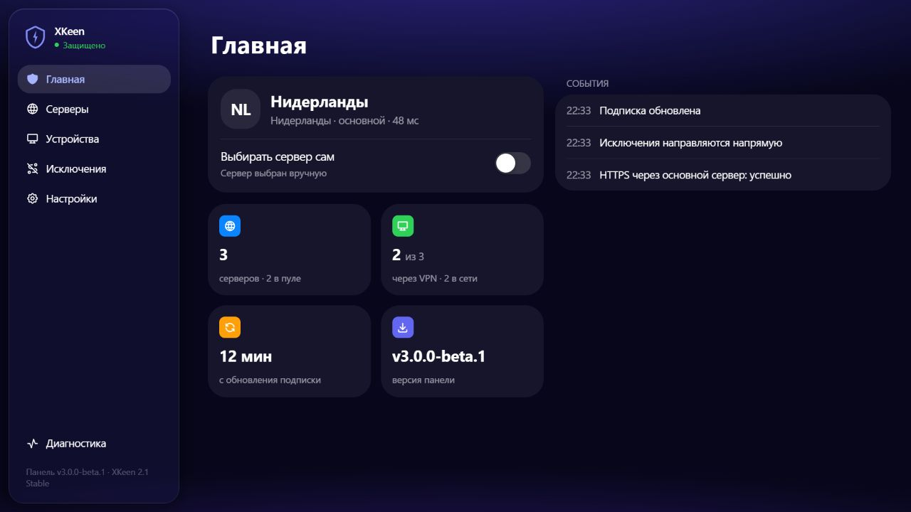
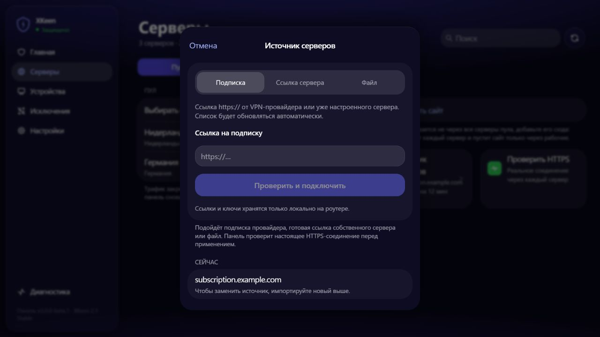
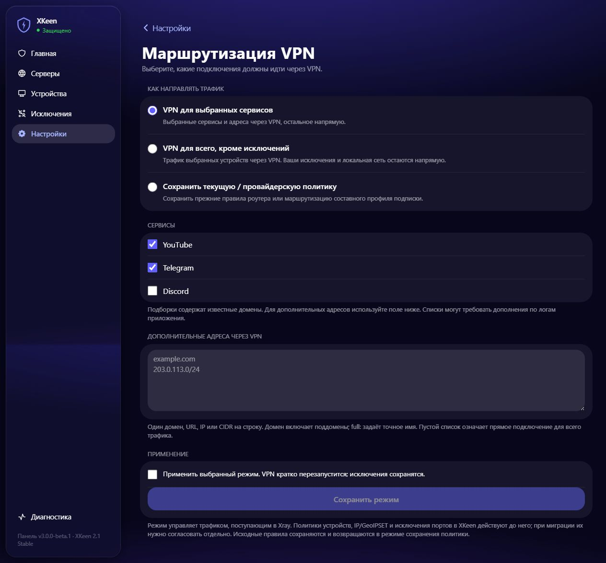
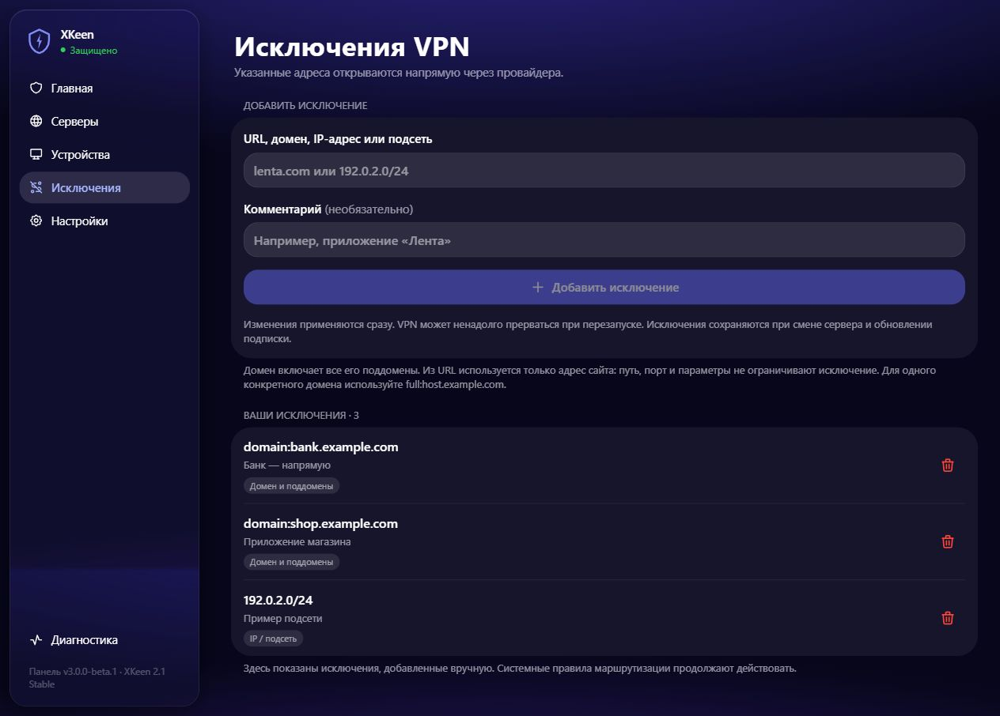
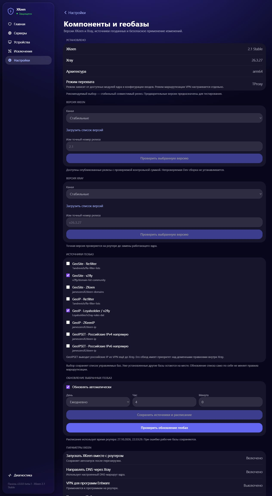
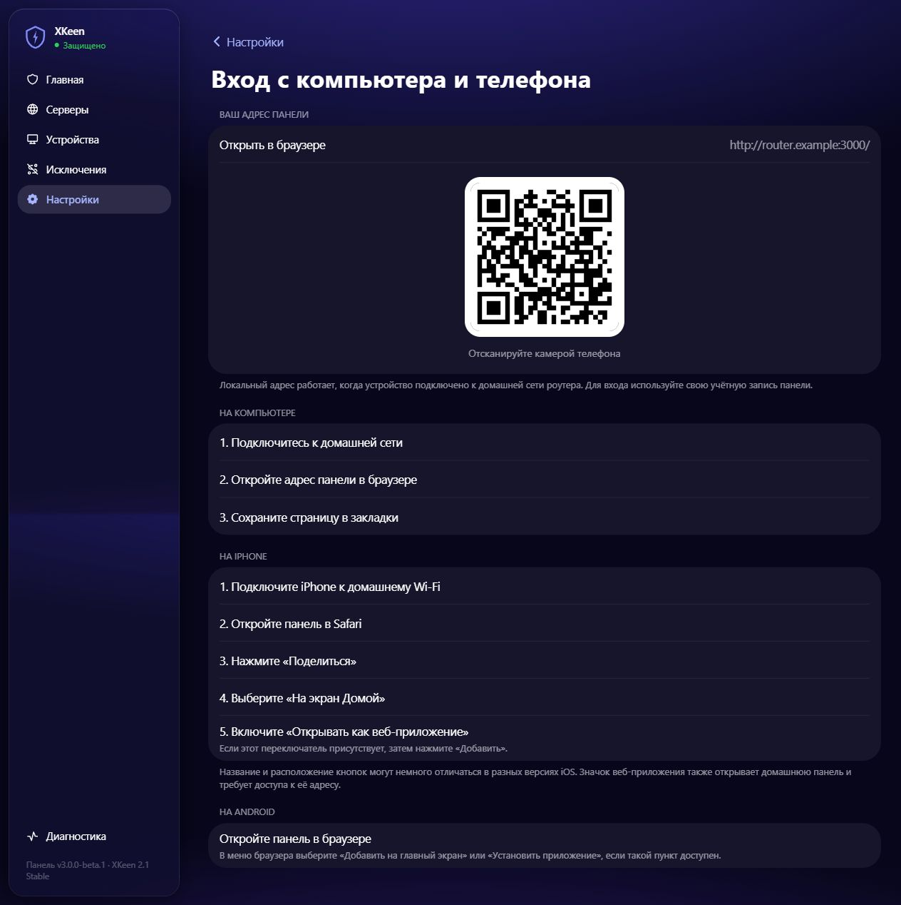
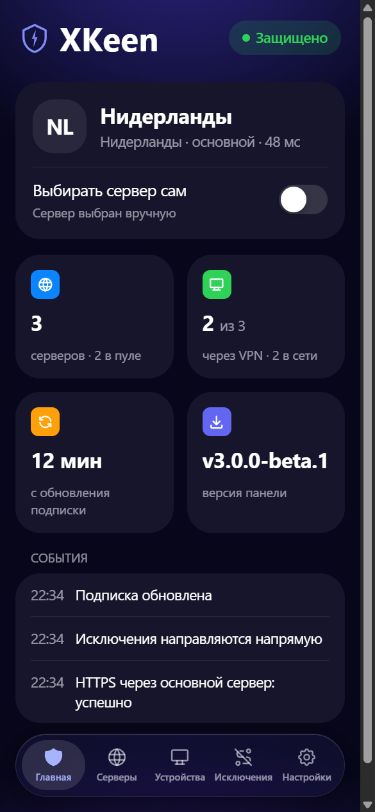

# XKeen Panel — установка и управление роутером

Русскоязычный форк [Dearonski/xkeen-panel](https://github.com/Dearonski/xkeen-panel)
для Keenetic/Netcraze с Entware, [XKeen](https://github.com/jameszeroX/XKeen) и
[Xray](https://github.com/XTLS/Xray-core). Установка рассчитана на помощь агента:
пользователю не нужно разбираться в командах, архитектуре процессора и JSON.

> Первый выпуск этой ветки — предварительный. Проверки на временных окружениях
> и сборка под архитектуру не заменяют испытания каждой физической модели.
> Перед изменениями агент обследует именно ваш роутер и сохраняет восстановление.



## Что умеет наша сборка

- Импорт подписки по HTTP(S), готовой ссылки сервера и локального файла.
- Импорт поддерживаемых серверов и составных Xray-профилей с отчётом
  несовместимых функций; проверка настоящим HTTPS-запросом до применения.
- Ручной выбор сервера, автопул и сохранение выбора после перезапуска.
- Выбор устройств и два режима: выбранные сервисы через VPN либо весь
  клиентский трафик через VPN, кроме исключений.
- Исключения URL/доменов, точных доменов `full:`, IPv4/IPv6 и подсетей CIDR.
- Выбор доступной версии XKeen/Xray, предварительный план изменения,
  проверка файлов, резервная копия и восстановление.
- Выбор источников геобаз, ручное обновление и отдельное расписание.
- Обновление кода панели из **этого форка**. Автообновление включается явно.
- Адаптивный интерфейс, вход с компьютера и телефона, QR-код адреса,
  добавление веб-приложения на экран iPhone.

## Установка для новичка

Используйте [скилл `xkeen-router-install`](skills/xkeen-router-install/SKILL.md)
в локальном агенте, которому доступны терминал, браузер и домашняя сеть.
Достаточно попросить: **«Установи XKeen и панель на мой роутер»**.

Скилл сам получает нужные файлы из публичного репозитория обычными средствами
командной строки. GitHub-аккаунт или GitHub-интеграция для установки не нужны.
Исходники не требуется прикладывать к чату. Готовые пакеты и скилл находятся
в [релизах](https://github.com/Sgadmer/xkeen-panel/releases).

Агент сначала спрашивает о прошлых установках и независимо от ответа проверяет
роутер. Он определяет модель/ревизию, прошивку, архитектуру, компоненты,
память, накопитель, Entware и имеющиеся VPN-службы. Затем объясняет, подходит ли
устройство, что необходимо подготовить и какие изменения предстоят.

От вас нужны подключённый к домашней сети компьютер, локальный ввод пароля
администратора и готовая ссылка подключения. Если необходим накопитель,
его нужно физически подключить. Пароли, ключи и коды подтверждения вводятся
локально; агент не должен публиковать их в переписке или GitHub.

VPN-клиент на компьютере может блокировать домашнюю сеть. До установки агент
проверяет доступ к роутеру и при необходимости помогает разрешить LAN-доступ
с сохранением VPN, через который работает агент. Отключение клиента допускается только после проверки альтернативного доступа агента. После проверки политики
компьютера агент сообщает: для настроенного доступа через этот роутер отдельный
VPN на ПК больше не требуется. Это относится к работе в домашней сети.

Подробности: [установка и совместимость](docs/installation.md).

## Если раньше уже была панель

Это отдельный сценарий миграции. Агент находит службы, правила маршрутизации,
списки доменов/IP, политики устройств и подписки, а затем предлагает перенос,
сохранение прежней установки для возврата или удаление после проверки.

Перед переключением вы увидите, какие настройки сохранятся, что будет отключено
и какие правила несовместимы. Две панели не должны одновременно менять один
Xray. Неизвестные файлы и старые резервные копии не удаляются без разбора.
Существующий HWID сохраняется до первого запроса подписки, когда он применим.

Подробнее: [перенос настроек и восстановление](docs/migration.md).

## Подписка или свой сервер

Подойдёт URL подписки `https://…` либо готовая ссылка сервера, например
`vless://…`, из уже настроенного приложения провайдера или собственного VPS.
Можно импортировать поддерживаемый файл. Одного IP сервера недостаточно.



Аренда и настройка самого VPS в сценарий не входят. Поддержка формата не
означает поддержку всех его функций установленным ядром: несовместимости
показываются явно, прежнее рабочее подключение сохраняется при ошибке.
Источник со статической ссылкой/файлом не скачивается по часовому расписанию;
автообновление списка относится к HTTP(S)-подпискам.

## Как направляется трафик

**Выбранные сервисы через VPN:** выбираете готовые категории или добавляете
свои домены/IP; остальной клиентский трафик идёт напрямую.

**Всё через VPN, кроме исключений:** подходящий клиентский трафик отправляется
через VPN; указанные исключения идут напрямую.



При миграции можно сохранить действующие правила. Составные профили провайдера
со своей маршрутизацией используют этот режим; для ручных режимов выбирается
обычный сервер. Несовместимое переключение отклоняется до изменения подключения.

Правила панели применяются к трафику, поступившему в Xray. Системные
IP/портовые исключения и GeoIPSET могут пропускать трафик ещё до Xray;
агент должен проверить и согласовать эти настройки с выбранным режимом.
GeoIP и GeoSite являются наборами данных, а не автоматическим определителем
блокировок каждого приложения.



Обычный домен включает поддомены. Из URL берётся hostname: путь и параметры
не ограничивают правило. Для точного домена используйте `full:host.example.com`.

## Версии, геобазы и обновления



В разделе «Компоненты и геобазы» показаны установленные версии, доступные
релизы, источники геоданных, расписание, ход операций и доступное восстановление.
Доступны опубликованные стабильные и предварительные релизы upstream;
доступность параметров зависит от выбранной версии и прошивки.

Это разные процессы:

| Что обновляется | Откуда и как |
|---|---|
| Панель | Наши релизы `Sgadmer/xkeen-panel`; ручное обновление и выбор автообновления |
| XKeen | Официальные выпуски `jameszeroX/XKeen`, с проверкой совместимости |
| Xray | Официальные выпуски `XTLS/Xray-core` для архитектуры роутера |
| Геобазы | Выбранные источники, отдельное расписание |
| Подписка | Данные вашего провайдера; по умолчанию каждый час |

Обновления первоначальной панели можно переносить в форк через отдельную
ветку: получить upstream, разрешить конфликты, выполнить тесты и выпустить
наш релиз. Роутеры не устанавливают непроверенный код upstream напрямую.

## Как потом открыть панель

После установки агент показывает **ваш фактический адрес**, а раздел
«Вход с ПК и телефона» содержит адрес и QR-код без паролей и токенов.



На компьютере откройте адрес в браузере и сохраните в закладки. На телефоне
подключитесь к домашнему Wi-Fi и откройте тот же адрес. Локальный адрес доступен
из домашней сети; установка не открывает административную панель в интернет.

На iPhone: **Safari → адрес панели → «Поделиться» → «На экран Домой» →
«Открывать как веб-приложение» (если доступно) → «Добавить»**.
Пункты меню могут отличаться в разных версиях iOS. Face ID/Touch ID для
passkey требуют подходящего HTTPS-домена; это проверяется отдельно.



## Совместимость и ограничения

ARM64 и MIPS little-endian — цели сборки. Проверка должна учитывать конкретную
прошивку, ядро, накопитель и доступную память; нельзя устанавливать бинарник
только по похожему названию модели. Объём необходимого места рассчитывается
с учётом полного комплекта, временных файлов и резервной копии.

Расширенные профили и ручная маршрутизация этой ветки ориентированы на Xray.
Наличие поддержки Mihomo в XKeen не означает полного совпадения возможностей
нашей панели. Непроверенные сочетания должны останавливаться с объяснением.

## Сборка и проверка разработчиком

Использованные инструменты: Go **1.27.1**, Node.js **24**, npm из поставки Node.

```sh
cd frontend
npm ci
npm run build
cd ..
go test ./...
python3 -m unittest discover -s installer/tests -v
python3 scripts/check-public-source.py
CGO_ENABLED=0 GOOS=linux GOARCH=arm64 go build -trimpath -ldflags='-s -w -X xkeen-panel/internal/version.Version=v3.0.0-beta.1' -o build/xkeen-panel-aarch64 .
```

Для демонстрации реального интерфейса с синтетическими данными запустите
локальную сборку с `-demo`: сервер слушает только `127.0.0.1:3300`, не читает
роутер и отклоняет изменения. Все скриншоты README получены в этом режиме.

## Авторы и участники

- **[Dearonski](https://github.com/Dearonski)** — автор исходной панели;
  [первоначальный репозиторий](https://github.com/Dearonski/xkeen-panel).
- **[Sgadmer](https://github.com/Sgadmer)** — сопровождение этого форка.
- **[OpenAI Codex](https://github.com/codex)** — помощь в разработке,
  установщике, тестах и скилле; отмечается соавтором соответствующих коммитов.
- XKeen и Xray — отдельные проекты своих авторов, указанных выше.

История upstream сохранена. Этот форк не объявляет новую лицензию на чужой
код; применимые условия исходных проектов и зависимостей сохраняются.

## Персональные данные

В репозиторий и релизные исходники не входят пользователи панели, рабочие
подписки, HWID, RCI-токены, пароли, настройки роутера, журналы и резервные копии.
Примеры используют синтетические параметры и документационные адреса.
Перед публикацией выполняется отдельная проверка исходников.
