# XKeen Panel

Панель для домашнего роутера Keenetic или Netcraze. Здесь можно выбрать, через какую страну откроется YouTube, закрепить сервер за Claude, оставить Steam напрямую и посмотреть, каким маршрутом ушло соединение с телефона. Управлять панелью можно из браузера на компьютере или телефоне.

[Скачать панель и навык установки · v3.0.2](https://github.com/Sgadmer/xkeen-panel/releases/tag/v3.0.2) · [Установка с нуля](docs/installation.md) · [Перенос действующего VPN](docs/migration.md)


## Что где находится

| Хочу… | Куда перейти |
| --- | --- |
| Установить панель и подключить первый сервер | [Установка и первый вход](#установка-и-первый-вход) · [Мастер настройки](#мастер-настройки) |
| Узнать, работает ли VPN и кто выбрал текущий сервер | [Главная](#главная) |
| Добавить подписку, сравнить серверы или собрать свой пул | [Серверы и подписки](#серверы-и-подписки) · [Мультипулы](#как-собрать-свой-мультипул) |
| Назначить VPN приложению, объединить AI и защитить соединения | [Сервисы](#сервисы) · [Один VPN для AI и аналитики](#один-vpn-для-ai-и-аналитики) · [Kill switch](#что-делает-kill-switch) |
| Оставить телевизор напрямую или переименовать телефон | [Устройства](#устройства) |
| Открывать отдельные сайты напрямую | [Исключения](#исключения) · [Защита и режим VPN](#защита-и-режим-vpn) |
| Узнать, куда обращалось устройство и каким путём ушёл запрос | [Журнал](#журнал) · [Шаблоны и запись](#шаблоны-запись-и-выгрузка) · [История на внешнем диске](#история-на-внешнем-диске) |
| Проверить нагрузку роутера и работу VPN | [Диагностика](#диагностика) |
| Добавить сервис, которого нет в списке | [Свои сервисы](#свои-сервисы) |
| Изменить параметры XKeen, порты, DNS, версию ядра или обновление баз | [Настройки](#настройки) · [Роутер и XKeen](#роутер-и-xkeen) · [Полный обход VPN: порты и адреса](#полный-обход-vpn-порты-и-адреса) |
| Перенести настройки на другой роутер или вернуть рекомендованные | [Перенос настроек](#перенос-настроек) · [Рекомендуемые настройки](#рекомендуемые-настройки) |
| Сменить пароль, создать запасные коды, входить по Face ID | [Вход и безопасность](#вход-и-безопасность) · [Адрес панели, HTTPS и Face ID](#адрес-панели-https-и-face-id) |
| Получать уведомления | [Уведомления](#уведомления) |
| Обновить панель или вернуть предыдущую версию | [Обновление и восстановление](#обновление-панели-и-восстановление) |

Руководство описывает выпуск **v3.0.2**. По сравнению с beta.6 журнал соединений стал отдельной вкладкой, настройки сгруппированы заново, появились свои сервисы, раздел «Вход и безопасность», перенос настроек и подтверждения перед действиями, которые ослабляют защиту. [Что нового](docs/releases/v3.0.2.md). Снимки экранов сняты из демонстрационного режима этой версии; экраны мастера и уведомлений оставлены от beta.4. Во всех публичных примерах используются вымышленные подписки, устройства и адреса. Набор кнопок зависит от ядра — программы, через которую роутер пропускает соединения. Название своего ядра видно в **Настройки → Роутер и XKeen**.

## Установка и первый вход

1. На компьютере в домашней сети скачайте и распакуйте архив навыка для **v3.0.2**. Внутри будет папка `xkeen-router-install` с файлом `SKILL.md` и подпапкой `references`. Сохраните их вместе. Аккаунт GitHub для скачивания не нужен. [Скачать xkeen-router-install.zip](https://github.com/Sgadmer/xkeen-panel/releases/download/v3.0.2/xkeen-router-install.zip)
2. Откройте распакованную папку в локальном агенте с доступом к браузеру и терминалу. Напишите **«Прочитай SKILL.md и помоги установить XKeen и панель на мой роутер. Хочу выбирать VPN отдельно для каждого сервиса»**. Подготовьте ссылку на подписку или готовую ссылку подключения к своему серверу. Пароли и одноразовые коды вводите локально.
3. Агент проверит модель, прошивку, свободное место, Entware и предыдущие установки. Если VPN на роутере уже работает, вы увидите, какие настройки удастся перенести и как вернуть прежнюю панель. Перед переключением агент сохранит резервную копию. Две работающие панели не должны одновременно менять правила одного роутера. Если провайдер привязал подписку к устройству по HWID, при переносе нужно сохранить его прежний идентификатор. [Перенос настроек и восстановление](docs/migration.md)
4. После установки агент покажет адрес именно вашей панели и проверит на подключённом устройстве доступ через VPN и прямой выход. Сохраните адрес в закладки. Чтобы открыть панель с телефона, подключитесь к тому же Wi-Fi и отсканируйте QR-код в **Настройки → Вход и безопасность → Адрес панели и QR-код**.

**Для самостоятельной установки** скачайте исходники и файл контрольных сумм из одного выпуска. В инструкции описаны проверка роутера, резервная копия, подготовка комплекта на компьютере и запуск установщика на роутере. Готовые сборки выпускаются для ARM64 и MIPS little-endian. Совместимость зависит также от модели и прошивки. [Файлы релиза v3.0.2](https://github.com/Sgadmer/xkeen-panel/releases/tag/v3.0.2) · [Пошаговая установка](docs/installation.md)

Чистая установка по этой инструкции готовит XKeen 2.1 с Xray. Для карточек сервисов и журнала соединений нужен работающий Mihomo. Если он уже настроен, агент проверит возможность установить только панель. Для режима `--panel-only` установщик также требует установленные XKeen и Xray.

При первой настройке создайте отдельные логин и пароль панели (от 8 символов). Отсканируйте QR-код **в приложении для одноразовых кодов** и введите сгенерированный код в панель. Этот QR-код содержит секрет входа. Другой QR-код, который позже появится в разделе **Адрес панели и QR-код**, содержит адрес панели и открывается обычной камерой. После первого входа создайте **запасные коды** в разделе [Вход и безопасность](#вход-и-безопасность): они пригодятся, если телефон с приложением потерян.

### Мастер настройки

Пока настройка не завершена, на главной и в настройках есть строка **Завершить настройку**. Мастер проверит текущее состояние и покажет шаг, с которого стоит продолжить. Если XKeen ещё отсутствует, он предложит инструкцию по установке и кнопку **Проверить снова**.

1. В **Серверы VPN** добавьте подписку, готовую ссылку сервера или файл. Если серверы уже подключены, можно продолжить с ними.
2. В **Режим VPN** выберите правила для вашего ядра.
3. В **Устройства** выберите, чьи подключения должен обрабатывать VPN. Если на роутере нет политики доступа `xkeen`, кнопка **Создать политику** появится при доступном интерфейсе управления Keenetic.
4. На шаге **Запуск** при первой настройке показаны две рекомендуемые настройки, обе включены. **Через VPN только сайты и приложения** записывает в список XKeen порты 80, 443, 596:599 и 50000:50030: это сайты, приложения и звонки Telegram. Всё остальное идёт напрямую, мимо VPN, и меньше нагружает роутер. Обычно это игры и торренты, но напрямую могут пойти и звонки в других мессенджерах. Эта строка есть, только пока XKeen ещё не запускался и порты не выбраны. **Обновлять панель автоматически** включает автообновление. Любую можно выключить здесь или изменить позже; при обновлении панели они не меняются. Нажмите **Запустить**. Мастер запускает XKeen, включает автозапуск и контроль рабочего сервера, затем проверяет соединение через VPN. После подтверждения связи нажмите **Открыть панель**. Если связь не подтверждается, перейдите в **Диагностика**. Кнопка **Позже** позволяет вернуться к панели до окончания настройки установленного XKeen.


## Главная

Верхняя карточка показывает страну, название текущего сервера и задержку. Строкой ниже указано, как он выбран: вручную, из автопула, автоматической заменой или по профилю провайдера. На снимке в начале руководства остальные сайты идут через автовыбор из пула «Все локации»: из восьми кандидатов роутер выбрал Стокгольм из подписки «Северный ветер». У сервиса со своим сервером в этот момент может быть другая локация.

- **Автоматически выбирать сервер** разрешает роутеру выбирать участника пула. Выключение закрепляет текущего участника, когда роутер уже сообщил его имя.
- Под карточкой есть быстрые переходы к серверам, устройствам, подписке и обновлению панели. «3 из 4 через VPN» означает, что для трёх устройств действуют правила VPN. Среди запросов этих устройств могут быть и прямые подключения.
- Блок **Защита** (Mihomo) одной строкой отвечает, всё ли закрыто. Если есть слабое место — выключен общий kill switch, неопознанный трафик идёт напрямую, AI-карточка открыта напрямую или без kill switch, у AI-карточек разные серверы, фильтр API Claude не активен — оно показано отдельной строкой со ссылкой туда, где это меняется. Ниже видно, через какой сервер сейчас идёт Claude и сколько устройств в сети работает мимо VPN.
- В **Событиях панели** видны последние изменения. Ссылка **Журнал соединений** рядом открывает [журнал](#журнал). Вверху показано состояние VPN: **VPN работает**, **VPN ищет сервер**, **VPN не работает** или **Нет интернета у провайдера**. Если VPN не работает, под карточкой сервера сказано, что происходит с трафиком: kill switch приостановил интернет или трафик идёт напрямую. Если не отвечает VPN отдельной карточки сервиса, это тоже написано здесь. Подробности — в **Диагностике**: там раздельно показаны интернет у провайдера и проверка VPN.

## Серверы и подписки

У подписки может быть десяток серверов в разных странах. На вкладке **Все серверы** вы видите, что прислал провайдер. На вкладке **Автовыбор** — из каких серверов разрешено выбирать роутеру и какой из них сейчас используется. Галочка отмечает текущий сервер. Через него идут **остальные сайты** — всё, для чего у сервиса нет своего выбора.


### Как добавить подписку, сервер или файл

Откройте **Серверы → Подписки и источники → Добавить источник**. Дайте источнику понятное имя. Можно добавить несколько подписок и использовать серверы из них одновременно. Это имя вы увидите рядом с сервером и при выборе маршрута для сервиса.

| Что у вас есть | Что выбрать в панели |
| --- | --- |
| Ссылка на список серверов от провайдера | **Подписка**. Вставьте ссылку. Когда провайдер изменит список, панель сможет скачать новые данные. |
| Ссылка на одно готовое подключение, например VLESS, VMess, Trojan или Shadowsocks | **Ссылка сервера**. Скопируйте ссылку подключения целиком из настроенного клиента. Одного IP-адреса сервера недостаточно. |
| Файл, который прислал провайдер | **Файл**. Выберите текстовый файл со ссылками или поддерживаемую конфигурацию JSON/YAML размером до 4 МиБ. Файлы и одиночные ссылки не обновляются по расписанию. |

Если провайдер сообщает срок подписки и остаток трафика, они видны в списке источников. За 3 дня до конца срока и при остатке 10% трафика на главной появится предупреждение. Если провайдер прислал к серверу короткое описание, например «Обход белых списков LTE», оно показано под названием сервера. Если сервер подписки не ответил вовремя, панель повторит загрузку, а прежние серверы останутся в работе.


Откройте добавленный источник, чтобы переименовать его, посмотреть число импортированных серверов и сборных профилей, обновить подписку или удалить её. Если часть записей использует неподдерживаемые функции, панель покажет пропуски. Чтобы обновить все подписки сразу, нажмите круглую стрелку вверху экрана **Серверы**. Чтобы изменить расписание, откройте **Настройки → Подписки и автоматика → Обновлять подписки** (та же страница открывается строкой **Подписки и автоматика** на экране серверов). Доступны интервалы от 15 минут до суток и вариант **Не обновлять**. Сообщение о пропущенных при импорте записях можно закрыть кнопкой **Скрыть**; оно появится снова, только если изменится.

Провайдер может при каждом обновлении менять параметры подключения серверов, оставляя прежние названия. Панель считает такой сервер тем же самым: он остаётся выбранным в сервисах, общем маршруте и мультипулах и сохраняет исправленную страну. Если адрес и порт сервера прежние, сохраняется и последний удачный замер задержки — иначе пулы, отобранные по задержке, пересобирались бы после каждого обновления подписки; следующая проверка заменит его. Неудачная проверка не переносится, как и замер сервера, который переехал на другой адрес. **Открытые соединения при таком обновлении не рвутся**: новые идут по новым параметрам, а прежние доживают через прежний обработчик маршрута — до своего конца, но не дольше 30 минут. Если провайдер сразу отключил старые параметры, такое соединение оборвётся само. Когда сервер или пул меняете вы, соединения по-прежнему переподключаются сразу. В журнале панель называет изменившиеся настройки, без их значений. Если после обновления одно название получили несколько серверов, панель не угадывает, и сервер нужно выбрать заново.

Если подписка перестала обновляться, потому что провайдер сменил её адрес, откройте источник и вставьте новую ссылку в поле **Новая ссылка подписки**. Серверы с прежними названиями останутся выбранными. Для источника, который использует профиль Mihomo, добавьте новую ссылку отдельным источником и удалите прежний.

Источник можно удалить в любой момент. Его записи исчезнут из каталога, а пулы заполнятся серверами других подписок. Сервис, которому был назначен отдельный сервер только из этой подписки, блокируется, пока вы не выберете другой; сервис с пулом блокируется, только если в пуле не осталось серверов. Для источника, который использует профиль Mihomo, панель отключит связанных провайдеров, а группа профиля, где был выбран удаляемый сервер, начнёт блокировать трафик до нового выбора.

### Как выбрать страну или один конкретный сервер

- **Нужен конкретный сервер.** Откройте **Серверы → Все серверы**, найдите локацию по названию, стране или имени подписки и нажмите на строку сервера. Вариант подходит, например, если сайт узнаёт ваш привычный адрес. Сервер останется выбранным вручную. Если в **Настройки → Подписки и автоматика** включено **Менять упавший сервер**, при отказе общего сервера панель сможет подобрать проверенную замену из той же страны. Закреплённые маршруты карточек Mihomo и составные профили сохраняют свой выбор.
- **Нужна страна, а сервер внутри неё может меняться.** На Mihomo откройте **Автовыбор → Пул автовыбора** и выберите страну. В пуле собраны серверы с этой меткой из всех подписок. Число рядом со страной показывает состав её собственного пула. Страна с нулём подходящих серверов недоступна для выбора.
- **Страна не важна.** Выберите **Все локации**. Если выключить **Автоматически выбирать сервер**, панель закрепит текущий сервер. Вернуться к автоматическому выбору можно тем же переключателем.
- **Нужен готовый режим подписки.** Ниже пула находятся **Режимы провайдера**. Если подписка содержит совместимый составной профиль, например «Самый быстрый» или «Автообход», его можно выбрать целиком. Какие серверы входят в этот профиль и как распределяется трафик, определил провайдер. Исключения стран, заданные для автовыбора панели, не переписывают его внутренние правила.

На вкладке **Все серверы** порядок групп по умолчанию алфавитный. В поле **Порядок стран** можно выбрать обратный порядок или сортировку по наименьшему пингу в каждой стране. Если порядок должен оставаться постоянным после проверки, оставьте алфавитную сортировку. Группа **Без страны** идёт последней среди стран. Галочка **Только ответившие** скрывает серверы без ответа и страны, где не ответил ни один. Вкладка, порядок, выбранная страна и галочка хранятся на роутере, поэтому экран выглядит одинаково на всех устройствах.

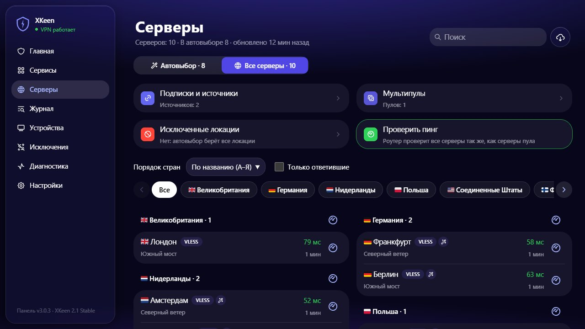

### Сколько серверов попадёт в пул и когда сменится локация

**Лимит пула «Все локации»** находится в **Серверы → Автовыбор**. Он относится только к этому пулу Mihomo. По умолчанию в него входит до **8** разных серверов. Укажите целое число от **1 до 256** и нажмите **Сохранить**. Если подходят 20 серверов и вы поставили лимит 200, в пул войдут все 20. Число в поле — максимум, который вы разрешаете использовать.

Панель собирает подходящие серверы всех подписок, убирает дубли, исключённые страны, сборные профили и узлы с неудачной HTTPS-проверкой. Сначала в пул попадают серверы с наименьшей известной задержкой. Если ещё есть место, могут попасть и непроверенные. Надпись **«В пуле 8 из 20 подходящих»** показывает число реально отобранных серверов и общее число кандидатов.

**Проверить пинг** загружает с самого роутера небольшой файл через каждый сервер: по 16 серверов одновременно, не дольше 5 секунд на сервер. Число в миллисекундах — время до первого ответа. Сервер, который ответил, но не передал файл, отмечен **Сервер отвечает, но связь замирает** и не попадает в автовыбор. Цвет числа: до 200 мс зелёный, до 500 мс оранжевый, медленнее или без ответа красный. Под сервером видно, когда его проверяли; при повторной проверке прежнее число остаётся бледным. Повторное нажатие останавливает проверку, уже измеренные серверы сохраняются. Проверка продолжается при переходе в другой раздел. В режиме Mihomo панель проверяет серверы и сама: серверы пула — раз в 30 минут, новые — сразу после обновления подписки, остальные — раз в 6 часов. Числа у серверов пула измеряет сам роутер: в пуле до 8 серверов — раз в минуту, в больших пулах реже. Если сервер пула «Все локации» перестал отвечать роутеру, панель в течение 15 секунд ставит вместо него следующий по скорости на 30 минут; открытые соединения при этом не рвутся. Если не отвечает ни один сервер пула, панель ничего не меняет: скорее всего, пропал интернет. Для скорости скачивания нужен другой замер.

Кнопка обновления рядом с сервером проверяет только этот сервер. Такая же кнопка в заголовке страны проверяет все серверы этой страны, а в заголовке автопула — его текущий состав. Во время проверки крутится значок у выбранных серверов, затем появляется результат. До её завершения остальные кнопки проверки заняты. Длинную строку стран можно прокрутить полосой прокрутки, кнопками по краям или свайпом на телефоне.

Галочка не обязана стоять у наименьшего числа в таблице. Таблица показывает результаты проверки каталога, а автоматический пул ведёт собственные фоновые замеры и использует их при выборе сервера для новых соединений. Германия может оставаться выбранной, даже если при последней ручной проверке быстрее ответила Швеция. Для готовых режимов провайдера момент переключения зависит от правил этого профиля.

### Как исключить страну

Откройте **Настройки → Подписки и автоматика → Не выбирать страны**. Список формируется из стран в ваших подписках. Отмеченные страны пропускаются при автовыборе и автоматической замене. Если конкретный сервер из такой страны нужен для одного сервиса, его можно назначить вручную. В выборе маршрута он помечен **Только вручную**.

Панель читает метку страны из названия локации. При нескольких флагах берётся первый. Если флага нет, панель ищет узнаваемое название или код страны. Например, сервер с названием `🇷🇺 → 🇩🇪` попадёт в группу России и при исключённой России выйдет из автовыбора. Если провайдер обозначил сервер как «Сомали», российский адрес подключения сам по себе не исключит его из пула. Чтобы исправить метку, нажмите карандаш рядом с нужным сервером во **Всех серверах**. Название из подписки сохранится.

### Как собрать свой мультипул

Допустим, для YouTube вам подходят все нидерландские серверы одной подписки и один шведский сервер другой. На Mihomo откройте **Серверы → Мультипулы → Создать мультипул**, дайте ему имя и выберите **По условиям и вручную**. В условиях укажите первую подписку и Нидерланды. В списке конфигов найдите шведский сервер по имени или источнику, отметьте его и нажмите **Сохранить мультипул**. Исключения стран действуют и для отмеченных вручную конфигов внутри пула.


Если нужны только фиксированные серверы, выберите **Отдельные конфиги**. Если нужны все подходящие серверы выбранных стран, выберите **По странам и подпискам**. Пункт **Все, включая новые подписки** включает в отбор и те источники, которые вы добавите позже. Так можно собрать, например, общий пул Нидерландов и Германии без ручного добавления каждого нового сервера.

Один мультипул вмещает до 256 разных серверов. После сохранения он появится в **Пуле автовыбора**, в конце списка **Все серверы** и в выборе маршрута в **Сервисах**. Через него можно пустить остальные сайты либо только один сервис. Если после изменения подписки или исключений состав пула опустеет, проверьте его счётчик и назначьте подходящие серверы. При включённом kill switch пустой пул блокирует назначенный ему трафик. Если для этого маршрута разрешён запасной прямой выход, соединение может пойти через домашнего провайдера. Увеличение лимита **Всех локаций** не добавит участников в отдельный мультипул.

### Если отдельный сайт открывается только через часть серверов Xray

В режиме пула Xray откройте **Серверы → Автовыбор → Сайты → Добавить сайт**. Введите домен или несколько доменов через запятую. Поддомены учитываются автоматически. В поле **Адрес проверки** можно указать конкретную страницу, например страницу входа, которая не работает через часть серверов. Если оставить поле пустым, панель проверит главную страницу первого домена.

Панель попробует открыть эту страницу через участников пула и покажет, сколько из них справилось. При наличии успешных проверок сайт получит только прошедшие серверы. Если проверку не прошёл ни один, сайт продолжит использовать весь пул. Повторная проверка запускается при смене пула, раз в 12 часов или кнопкой **Проверить снова**. На Mihomo для готовых сервисов используйте отдельные карточки ниже.

## Сервисы

Панель автоматически обновляет списки адресов сервисов раз в сутки: доменные наборы MetaCubeX/v2fly и официальный список голосовых IP ChatGPT. Обновление работает в обоих режимах VPN и не зависит от открытого браузера. Если источник недоступен или новый комплект не прошёл проверку, продолжает работать прежняя база. Широкие общие IP-сети Discord ограничены голосовым UDP-трафиком: обычный запрос к общему CDN больше не становится Discord только из-за IP. [Как работают списки и распознавание](docs/service-rules.md).

Здесь определяется, через какой VPN должен работать конкретный сервис. Например, вы можете оставить остальные сайты на автовыборе, назначить Claude один сервер в США, YouTube — пул Нидерландов, а Steam открывать напрямую. Назначение в карточке применяется к распознанным запросам этого сервиса от устройств, которые участвуют в правилах VPN.


### Готовые карточки

| Для чего | Какие сервисы есть в панели |
| --- | --- |
| ИИ | Claude / Anthropic, ChatGPT / OpenAI и общая карточка AI для других сервисов, в том числе Perplexity, Gemini и Mistral |
| Аналитика и диагностика | Общие сборщики аналитики, отчётов об ошибках и сигналов безопасности. Отдельный маршрут и kill switch; адреса обновляются из category-telemetry. Карточка находится после AI в закреплённом блоке. |
| Поиск, разработка и покупки | Google, GitHub, Amazon |
| Видео и музыка | YouTube, Spotify, Twitch, Netflix, Disney+, Prime Video, Hulu, HBO |
| Соцсети и мессенджеры | Telegram, Discord, Instagram, WhatsApp, Facebook, X (Twitter), LINE |
| Игры | Steam, PlayStation, Xbox |

У YouTube и Google отдельные назначения, как и у Prime Video и Amazon. Можно выбрать одну подписку для видео, а другую — для остальных сервисов Google.

### Свои сервисы

Если нужного сервиса нет среди готовых карточек, создайте свою (Mihomo): **Сервисы → Свой сервис**. Дайте карточке название и перечислите адреса по одному в строке — домен (с поддоменами), `full:` и точное имя, ссылку, IP-адрес или подсеть. Своих карточек может быть до 30, в каждой до 200 адресов.

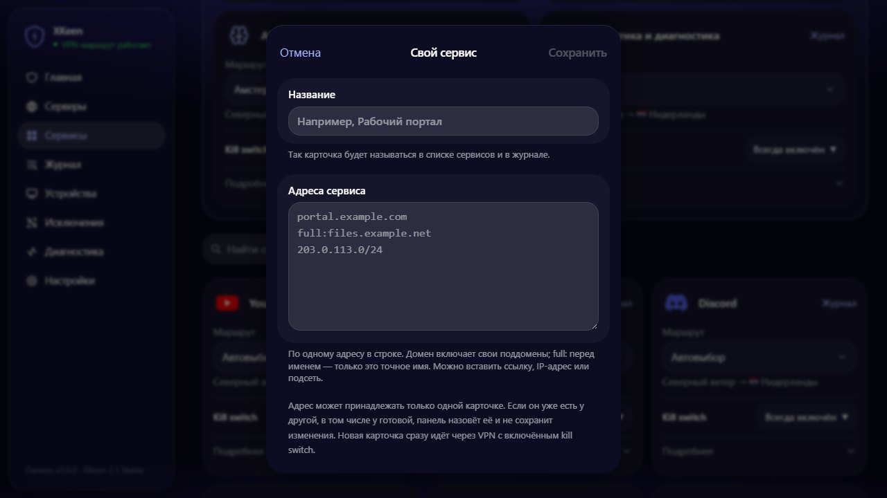

Своя карточка ведёт себя как готовая: у неё свой маршрут, свой kill switch, ссылка в журнал и место в списке. Новая карточка сразу идёт через автовыбор VPN с включённым kill switch; изменить название, адреса или удалить её можно в **Подробнее**.

Две вещи не дают своей карточке ослабить остальные:

- **Адрес принадлежит одной карточке.** Если адрес уже относится к другой карточке — по её встроенным доменам, обновляемому списку или сетям, — панель назовёт эту карточку и не сохранит изменения. Так свою карточку нельзя использовать, чтобы увести адрес Claude или другого сервиса на другой маршрут.
- **Правила своих карточек стоят после правил всех готовых.** Даже если списки готовой карточки позже пополнятся адресом из вашей, запрос достанется готовой.

### Один VPN для AI и аналитики

Четыре карточки **Claude → ChatGPT → AI → Аналитика и диагностика** собраны в отдельный блок. Их порядок закреплён: они не появляются в списке перетаскивания.

**Крайне рекомендуем один конкретный VPN-сервер для всех четырёх карточек.** AI-приложения и агенты отправляют не только сообщения: есть ещё общие запросы аналитики, отчётов об ошибках и проверки безопасности. Они могут попасть в карточку аналитики, а не самого AI. При разных серверах сервис может увидеть разные выходные IP. Один конфиг помогает сохранить последовательный маршрут, особенно для Claude / Anthropic. Один и тот же пул не гарантирует один выходной сервер для всех соединений.

Когда вы выбираете другой маршрут в одной из этих карточек, сначала открывается предупреждение с видимым отсчётом **5 секунд**. До конца отсчёта недоступны кнопки применения. Отменить можно сразу: кнопкой **Отмена**, крестиком, клавишей Escape или кликом снаружи. Само открытие окна ничего не меняет. Затем можно выбрать:

- **Применить ко всем четырём** — на Mihomo группа изменится одной проверенной операцией; при ошибке сохранится прежний комплект маршрутов.
- **Только для…** — изменится одна выбранная карточка.
- **Отмена** — все настройки останутся прежними.

Настройки kill switch сохраняются. Прямой выход нельзя применить ко всей группе: Claude требует VPN. При обновлении панели ваши текущие серверы автоматически не заменяются общим.

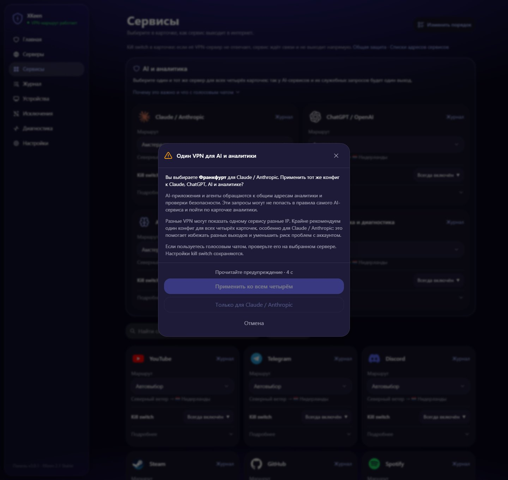

**Если нужен голосовой чат.** Для голоса Claude и ChatGPT подходят не все VPN-локации, даже если переписка работает. Иногда нужно попробовать несколько серверов. После выбора проверьте и переписку, и настоящий голосовой разговор. Если голос не нужен, выбирайте любую локацию, где нормально работает сам сервис.

Голосовые IP **ChatGPT** загружаются из [официального списка OpenAI](https://openai.com/chatgpt-voice.json) и используют сервер или пул его карточки, включая её kill switch. Для **Claude** добавлен известный голосовой IP; это точечное правило, а не полный обновляемый список всех будущих адресов. Новый неизвестный адрес может попасть в общий маршрут. Роутер не может гарантированно определить приложение только по общему или скрытому IP. [Подробности голосовых правил](docs/service-rules.md#голосовой-claude-и-chatgpt).

### Как назначить сервер или пул

1. Откройте **Сервисы**, найдите карточку и нажмите **Маршрут**. Для YouTube, ChatGPT и Claude предусмотрены отдельные карточки.
2. Выберите подходящий вариант из таблицы ниже. Готовые режимы и отдельные серверы сгруппированы по имени подписки. Название и значки, которые вы дали подписке, помогут отличить одинаковые локации.
3. Для карточек блока AI сначала прочитайте предупреждение и после отсчёта выберите, менять одну карточку или всю группу. Для остальных сервисов применяется обычный выбор.
4. Посмотрите строку под полем маршрута. Там появится текущая локация и, если известно, имя подписки, например **Северный ветер → Швеция**. При смене сервера в пуле подпись обновится. Если данных о локации пока нет, в карточке появится «Локация неизвестна». Если VPN карточки перестал отвечать, ниже появится красная строка **VPN этой карточки не отвечает**. Посмотреть, какое правило выбрал роутер для конкретного подключения, можно в **Журнале**: ссылка **Журнал** в углу карточки открывает его уже с фильтром по этому сервису.

Когда карточек больше шести, над ними появляется поле **Найти сервис**. Пояснения к блоку AI свёрнуты под строкой **Почему это важно и что с голосовым чатом**.


| Выбор в карточке Mihomo | Как пойдёт трафик |
| --- | --- |
| **Автовыбор** | Распознанные запросы сервиса идут через VPN-пул **Все локации**. Роутер выбирает подходящий сервер. |
| **Пулы стран**, **Пулы подписок** или **Мультипулы** | Роутер выбирает только среди участников назначенного пула. Подходит, если нужна определённая страна, серверы одной подписки или свой набор проверенных серверов. |
| Отдельный сервер в группе подписки | Распознанные запросы идут на закреплённый сервер. Выбор основного пула в «Серверах» можно менять независимо. |
| **Режим провайдера** | Применяется совместимый составной профиль подписки. Поведение определяется правилами самого профиля. |
| **Напрямую** | Сервис работает через обычное соединение интернет-провайдера. Для Steam это исходная настройка. У Claude доступны только VPN-маршруты. |

**Изменить порядок** позволяет перетащить остальные сервисы за ручку или передвинуть стрелками. Блок AI и аналитики закреплён отдельно и в этот список не входит. Порядок остальных карточек сохраняется в этом браузере. После обновления старой установки может появиться предложение **Автовыбор для сервисов**. Нажатие **Применить** переводит карточки с прежних правил роутера на исходные маршруты и сохраняет сделанные вручную назначения.

### Что делает Kill switch

Например, вы закрепили сервер за ChatGPT. Если сервер перестанет отвечать, при включённой защите запросы к распознанным адресам ChatGPT будут ждать рабочего VPN. Магазин или игра, для которых выбрано **Напрямую**, продолжат открываться через обычное соединение.

В **Настройки → Защита** находится общий переключатель Mihomo. По умолчанию он включён. В каждой карточке можно выбрать один из трёх режимов. У карточки с маршрутом **Напрямую** переключателя нет: защищать нечего.

Включить защиту можно одним нажатием. Выключение — общего переключателя или в карточке — сначала открывает окно с объяснением последствий и отсчётом **5 секунд**; отменить можно сразу. Так же подтверждаются перевод устройства мимо VPN, режим «только по списку блокировок» и остановка прокси.

| Значение в карточке | Если у сервиса перестал работать VPN |
| --- | --- |
| **Всегда включён** | Запасной прямой выход закрыт даже при выключенном общем переключателе. Это исходное значение карточек. |
| **Как в настройках** | Действует общий переключатель. Если его выключить, сервису будет разрешён запасной выход напрямую. |
| **Всегда выключен** | Сервису разрешён выход напрямую при отказе VPN, даже если общий переключатель включён. |

Эти правила действуют, пока Mihomo обрабатывает трафик. В карточке Claude отдельно виден статус фильтра роутера для опубликованных сетей Anthropic API. Этот фильтр блокирует прямые соединения к данным диапазонам независимо от Mihomo. Прочие домены и сторонние запросы приложения имеют отдельные правила. [Подробнее о защите при обрыве VPN](docs/selective-guard.md)

### Зачем в карточке логин и пароль прокси

При обычном входе в ChatGPT или Claude по домашнему Wi-Fi **вводить эти данные не нужно**. Роутер сам применяет маршрут к известным адресам сервиса. Список таких адресов доступен в **Подробнее → Домены сервиса**.

Иногда приложение обращается также к сторонним адресам, например загружает файлы. Если у приложения есть настройка **HTTP-прокси**, в карточке можно открыть **Подробнее → Прокси для приложения → Настроить прокси вручную** и ввести выданные адрес, логин и пароль **в самом приложении**. Эти данные дают доступ к прокси на роутере. По выбранному маршруту пойдут запросы, которые приложение передаст этому прокси. Если приложение предлагает запасной прямой выход при отказе прокси, отключите этот запасной выход. Пароль от учётной записи ChatGPT или Claude для этой настройки не нужен.

## Устройства

Выберите, для каких телефонов, компьютеров и телевизоров роутер должен применять правила VPN. Выключите переключатель у телевизора, чтобы он ходил напрямую. Оставьте переключатель у телефона включённым, чтобы на нём работали назначения из карточек сервисов.

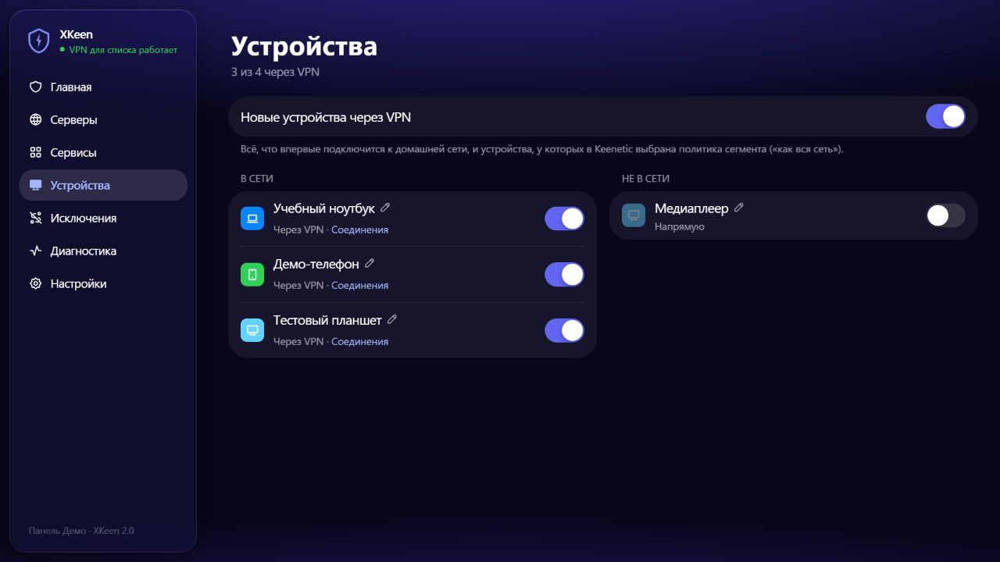

- **Выключение VPN у устройства** требует подтверждения с отсчётом 5 секунд: карточки сервисов и kill switch на такое устройство не действуют, и сервисы увидят ваш домашний адрес. Включение срабатывает сразу.
- **Новые устройства через VPN** задаёт выбор для тех, кто впервые подключится к домашней сети. Он действует и для устройств с политикой Keenetic «как вся сеть». Выключение тоже подтверждается.
- Когда устройств больше восьми, появляется поле **Найти устройство** (по имени или MAC-адресу). Длинный список **Не в сети** свёрнут до одной строки; кнопка **Показать** раскрывает его, и выбор запоминается в этом браузере.
- **Карандаш рядом с именем** позволяет переименовать зарегистрированное устройство. Если роутер ещё не запомнил его, введите имя и нажмите **Зарегистрировать**. Это имя будет видно и в штатном списке роутера.
- **Удалить регистрацию** удаляет сохранённое имя. Индивидуальные правила VPN и пробросы портов могут сброситься. Подключённое устройство может тут же появиться снова.
- **Журнал** в строке устройства открывает [журнал](#журнал) с уже выбранным телефоном или компьютером. Это удобно, если имя сайта заранее неизвестно.

## Исключения

Откройте **Исключения** в главном меню, чтобы добавить адрес для прямого подключения. Введите адрес, при желании добавьте комментарий и нажмите **Добавить исключение**. Исключения сохраняются при смене сервера и обновлении подписки. Mihomo применяет их без перезапуска ядра.

| Что ввести | Что попадёт под исключение |
| --- | --- |
| `example.org` | Сайт и все его поддомены. |
| `full:shop.example.org` | Только это точное имя. |
| `*.example.org`, `www.example.*`, `cdn-*.example.org` | **Шаблон**: звёздочка заменяет любую непустую часть имени. `*.example.org` — это поддомены без самого `example.org`; `www.example.*` — имя `www.example` в любой зоне. В шаблоне допустимы латинские буквы, цифры, дефис, точка и до четырёх звёздочек. |
| `192.0.2.10` или `192.0.2.0/24` | IP-адрес или подсеть. |
| Ссылка на страницу | Панель возьмёт из неё имя сайта. |

Слишком широкий шаблон панель не примет: `*`, `*.com`, `*.co.jp` и подобные захватили бы целую доменную зону.

У каждой записи есть переключатель (Mihomo): выключенное исключение остаётся в списке, но не действует. Карандаш открывает правку адреса и комментария. Корзина удаляет запись; ещё несколько секунд её можно вернуть кнопкой **Вернуть**. Из подробностей записи [журнала](#журнал) адрес попадает сюда одной кнопкой **Добавить адрес в исключения**.

**Исключение не может открыть лазейку в защищённой карточке.** Если адрес относится к карточке сервиса, у которой включён kill switch и выбран VPN, панель откажет и назовёт эту карточку: маршрут такого адреса выбирается в самой карточке. Чтобы всё же пустить его напрямую, выберите в карточке **Напрямую** или выключите её kill switch — это осознанное действие с подтверждением. Шаблон не принимается, если он задевает адреса любой карточки. Запись, которая была добавлена раньше и теперь пересекается с защищённой карточкой, помечена предупреждением. Правила Claude стоят выше исключений в любом случае.


## Журнал

**Журнал** — отдельная вкладка главного меню (на Mihomo). Он отвечает на вопрос «куда обращалось устройство и каким путём ушёл запрос». Соединения, блокировки QUIC, события kill switch и ошибки показаны в одной ленте, в одинаковых карточках с иконками сервисов. Попасть сюда с готовым фильтром можно из карточки сервиса, из строки устройства и из уведомления о срабатывании kill switch.

### Три периода

| Период | Что показывает | Что нужно |
| --- | --- | --- |
| **Сейчас** | Открытые в эту минуту соединения и свежие события защиты. | Ничего. |
| **Недавние** | Соединения, которые уже закрылись: до 5 000 последних записей не старше часа. Хранятся в памяти роутера и начинаются заново после перезапуска панели. На роутерах с памятью меньше 192 МиБ — до 1 000 записей. | Включено по умолчанию. |
| **Сутки** | Записи за последние 24 часа. Переживают перезапуск. | [Внешний диск](#история-на-внешнем-диске). |

Для периода **Недавние** есть вид **По сайтам**: вместо ленты — список адресов с числом обращений через VPN, напрямую, заблокированных и с ошибками. Нажатие на адрес открывает его записи в ленте.

### Как найти нужное

1. Выберите период, затем устройство, сервис и тип события: соединения, kill switch, QUIC или ошибки. **Поиск** находит домен, IP, правило и сервер.
2. Прочитайте маршрут в карточке слева направо: сервис → выбранный пул или сервер → известный выход. Ниже указано сработавшее правило и, когда известна, подписка. Нажмите карточку, чтобы открыть подробности. Из подробностей можно оставить в ленте только этот адрес или это устройство, скопировать запись и добавить адрес в [исключения](#исключения).
3. **Пауза** фиксирует экран. Она не останавливает интернет и не выключает запись. В периодах **Недавние** и **Сутки** кнопка **Показать ещё** подгружает более старые записи.

Выбранные период и фильтры записаны в адресе страницы и запоминаются в этом браузере: после перехода в другой раздел или перезагрузки журнал открывается таким, каким вы его оставили. Ссылку с фильтрами можно сохранить в закладки.

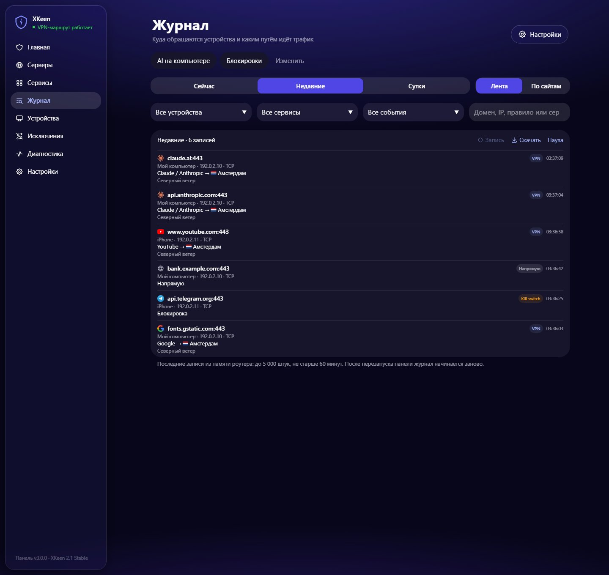

### Шаблоны, запись и выгрузка

- **Шаблоны.** Настройте период, вид и фильтры и нажмите **Сохранить как шаблон**. Шаблон появится кнопкой над журналом на всех ваших устройствах: одно нажатие — и снова «Claude на компьютере» или «Блокировки». Шаблонов может быть до 30; переименовать или удалить их можно кнопкой **Изменить**.
- **Запись.** Выберите устройство и нажмите **Запись**, затем воспроизведите проблему на этом устройстве и нажмите **Остановить**. В ленте останутся только соединения этого устройства за время записи. Запись живёт, пока открыта вкладка браузера.
- **Скачать** сохраняет показанные записи в текстовый файл с табуляцией: его открывает любой табличный редактор.

Если используется пул Xray, пунктиром отмечен его текущий сервер: он мог смениться после открытия соединения. Старая запись хранит наблюдавшийся в тот момент маршрут; панель не подставляет в неё сегодняшний выбор пула.

Событие **Kill switch** означает наблюдавшийся отказ выбранного VPN или срабатывание управляемого защитного правила. Обычный REJECT, например блокировка рекламы, не называется kill switch. **QUIC** помечается отдельно. Отсутствие записей о блокировке само по себе не доказывает отсутствие утечек. В HTTPS роутер может видеть домен или IP и порт, но не содержимое переписки и не полный путь страницы.

### История на внешнем диске

Кнопка **Настройки** на странице журнала (или **Настройки → Журнал**) открывает два независимых хранилища. **Недавние соединения** в памяти роутера включены по умолчанию; их можно выключить там же. **Журнал за сутки** на внешнем диске **выключен по умолчанию** — пока он выключен, панель не открывает базу и не создаёт очередь дисковой записи.

Если нужна история за сутки:

1. Откройте **Журнал → Настройки**.
2. Выберите обнаруженный внешний диск и папку журнала. Панель показывает свободное место и предлагает начальный путь. Нельзя выбрать внутреннюю память, временный RAM-диск или сетевую папку. Папка должна оставаться внутри выбранного накопителя.
3. Включите **Сохранять журнал на диск**, задайте ограничения и сохраните настройки.
4. В журнале выберите период **Сутки**, затем нужное устройство, сервис или событие.

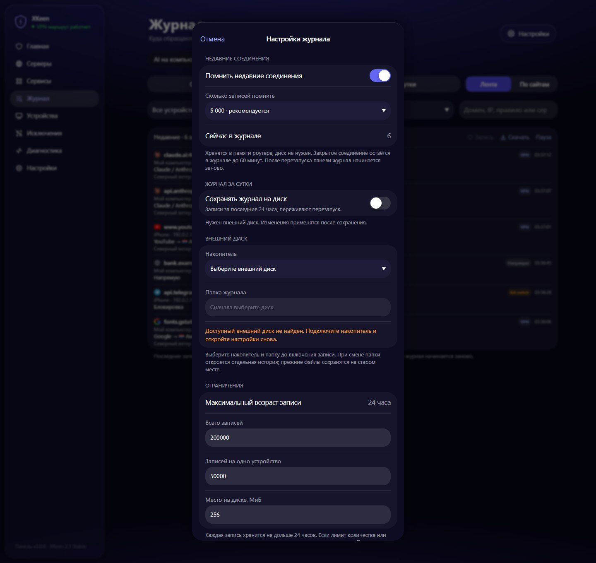

| Ограничение | Обычное начальное значение |
| --- | --- |
| Возраст каждой отдельной записи | 24 часа |
| Записей всего | 200 000 |
| Записей на одно устройство | 50 000 |
| База и её служебные файлы | 256 МиБ |

Лимиты количества и размера можно менять. На устройствах с общей RAM менее 192 МиБ предлагаются меньшие значения: 30 000 записей всего, 5 000 на устройство и 32 МиБ. При недостатке свободной RAM включение записи отклоняется. На поддерживаемых ARM64-роутерах используется SQLite; на MIPS дисковая история пока недоступна, но текущий журнал работает.

Возраст считается **для каждой записи отдельно**. Записи старше 24 часов скрываются из результатов и удаляются небольшими порциями во время работы журнала. При достижении лимита места или количества первыми удаляются самые старые записи, поэтому фактическая история может быть короче суток.

Запись идёт небольшими пакетами через ограниченную очередь. Если очередь переполнена или диск недоступен, панель пропустит часть метаданных и покажет счётчик. Она не ждёт записи на диск при обработке сетевых событий и не переносит журнал во внутреннюю память при отключении накопителя. Это ограничивает нагрузку, но не превращает домашний журнал в гарантированную запись каждого пакета.

Выключение истории останавливает запись, не стирая прежние файлы. Смена папки открывает отдельный журнал; старые данные остаются на прежнем месте. В историю попадают только подключения, которые увидел VPN-обработчик, а не весь трафик домашней сети. [Все условия работы и хранения](docs/connection-history.md).

## Диагностика

Здесь проверяют, работает ли VPN, и управляют ядром. Сверху — проверки и кнопки, ниже — события панели и графики нагрузки.

- **Проверки** показывают, работает ли ядро, есть ли интернет у роутера, прошла ли проверка VPN и включена ли замена упавшего сервера. При Re:filter отдельная строка показывает маршрут для остального трафика.
- **Проверить конфигурацию** помогает найти ошибку в настройках ядра. Рядом можно запустить остановленный прокси, остановить его или перезапустить XKeen. Перезапуск требует повторного нажатия, его итог пишется под кнопками. При включённом kill switch панель на время перезапуска останавливает выход устройств в интернет. **Остановить прокси** открывает подтверждение с отсчётом 5 секунд: пока прокси остановлен, устройства выходят в интернет напрямую.
- **Дополнительно** позволяет синхронизировать серверы Mihomo и перепроверить назначенные маршруты. При Xray здесь доступны сборка пула из подписки или синхронизация существующего пула. Перед первой сборкой панель предупреждает о перезаписи маршрутизации и сохраняет копии конфигурации.
- **События панели** содержат сообщения самой панели. Если сервер исчез после обновления или проверка завершилась ошибкой, смотрите записи в момент действия. Здесь же отмечается пауза входа после неверных попыток. Сообщение «связь в порядке» пишется при смене состояния и раз в час, а не при каждой проверке. Куда шёл трафик устройства, показывает [журнал](#журнал).

### Нагрузка роутера и трафик

Выберите интервал **1, 5 или 15 минут**. Для процессора показана загрузка в процентах, для памяти — доля и объём, для температуры — самый горячий доступный датчик. График **Интернет-трафик** показывает приём и передачу через интернет-интерфейс роутера. Скорость указана в битах в секунду, объём за время наблюдения — в байтах. Здесь учитывается и прямой трафик, и VPN. Пока вкладка браузера скрыта, графики не запрашивают данные.


## Настройки

Откройте **Настройки** в главном меню. Разделы названы по тому, что вы хотите сделать.

| Раздел | Что в нём |
| --- | --- |
| **Защита** | Сводка слабых мест, общий kill switch, режим для неопознанного трафика. |
| **Подписки и автоматика** | Как часто обновлять подписки, менять ли упавший сервер, какие страны не брать. |
| **Журнал** | Сколько соединений помнить и где хранить суточную историю. |
| **Уведомления** | Какие события присылать на это устройство. |
| **Вход и безопасность** | Пароль, приложение для кодов, запасные коды, ключ доступа, адрес панели. |
| **Роутер и XKeen** | Версии, списки адресов сервисов, список блокировок Re:filter, версия и DNS ядра Mihomo, параметры XKeen, порты. |
| **Перенос настроек** | Сохранить настройки в файл и загрузить их на другом роутере или после переустановки. |
| **Рекомендуемые настройки** | Что отличается от рекомендованного и кнопка, чтобы вернуть. |
| **О панели и обновление** | Версия, автообновление, выбор между стабильными и бета-версиями, установка любой подписанной версии. |

XKeen на роутере перехватывает подключения выбранных устройств. Ядро, **Mihomo** или **Xray**, применяет к ним правила. Название ядра подскажет, какими инструкциями ниже воспользоваться. **Выйти** завершает сеанс в браузере. VPN на роутере продолжает работать.

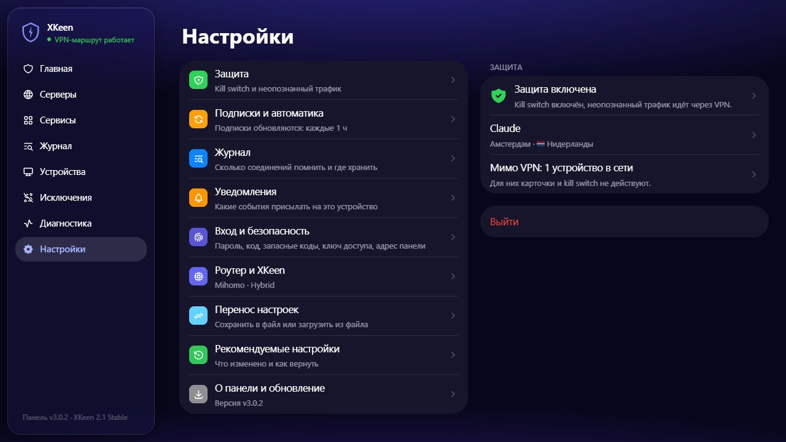

### Защита и режим VPN

**С Mihomo** откройте **Настройки → Защита**. Вверху та же сводка, что и на главной. Ниже — общий **Kill switch** и блок **Неопознанный трафик**: что делать с адресами, которым не назначена отдельная карточка.

| Режим Mihomo | Что происходит с остальными запросами |
| --- | --- |
| **Защищённый режим** — рекомендуется | Неопознанные запросы тоже идут через основной VPN. Если рабочий VPN недоступен, защищённый маршрут блокируется. Выбор режима включает общий kill switch; настройки отдельных карточек сохраняются. |
| **Только по списку блокировок** | Адреса из Re:filter идут через основной VPN. Остальные адреса без отдельного правила открываются напрямую. В списке есть и сервисы с региональными ограничениями. Переход в этот режим подтверждается с отсчётом 5 секунд. |

**Карточки сервисов и их kill switch работают в обоих режимах.** Прямые исключения, локальные сети и системные прямые правила сохраняются. Неизвестный дополнительный адрес приложения может отсутствовать и в карточке, и в Re:filter. В режиме по списку такой запрос способен выйти напрямую даже при включённом kill switch карточки. Защищённый режим закрывает этот вариант, но сам по себе не относит неизвестный адрес к серверу нужного приложения: используется общий VPN. Поэтому для AI важен согласованный выбор карточек и проверка их реальных соединений.

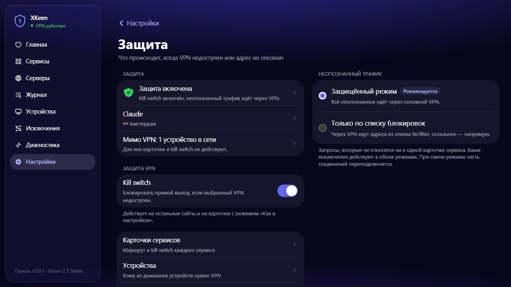

При смене режима часть открытых соединений может переподключиться. Назначенные серверы карточек и ваши исключения сохраняются. [Порядок правил и границы распознавания](docs/service-rules.md).

Списки адресов сервисов и база Re:filter находятся в разделе [Роутер и XKeen](#роутер-и-xkeen).

**С Xray** в разделе **Защита** доступны три варианта.

| Режим | Что произойдёт |
| --- | --- |
| VPN для выбранных сервисов | Отметьте сервисы и при необходимости впишите дополнительные домены, IP или подсети по одному на строке. Остальной трафик идёт напрямую. |
| VPN для всего, кроме исключений | Подключения выбранных устройств идут через VPN. Локальная сеть и прямые исключения доступны своим обычным путём. |
| Сохранить текущую / провайдерскую политику | Применяются исходные правила установки или составного профиля провайдера. Чтобы перейти к ручному режиму при активном составном профиле, сначала выберите обычный сервер в разделе «Серверы». |

Для применения в Xray отметьте подтверждение и нажмите **Сохранить режим**. VPN кратко перезапустится. Устройства, порты и сети, которые сам XKeen пропускает напрямую, до правил Xray не доходят.

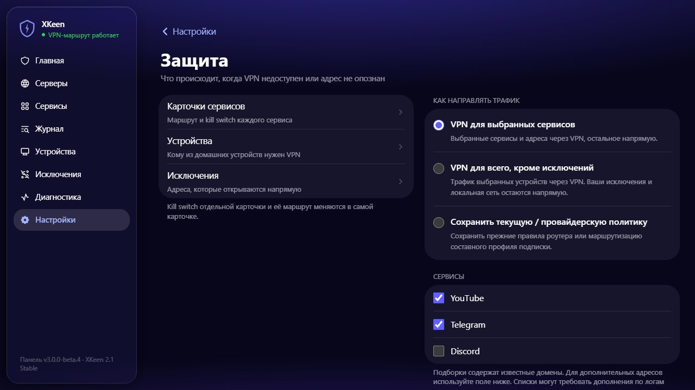

### Роутер и XKeen

В **Настройки → Роутер и XKeen** откройте блок **Установлено**. Здесь видны ядро, версия XKeen, архитектура процессора и режим перехвата. Например, «Hybrid» описывает, как роутер передаёт подключения в ядро. Какие сайты пойдут через VPN, задаёт раздел **Защита**.


**С Mihomo** здесь четыре блока.

- **Списки адресов сервисов** — по ним роутер узнаёт, к какой карточке относится запрос. Показаны число списков и правил, источник, время последней и следующей проверки. Панель обновляет их сама раз в сутки; кнопка **Проверить обновление сейчас** запускает проверку вручную. При ошибке работает прежняя база, выбранные в карточках серверы сохраняются.
- **Список блокировок Re:filter** — число сайтов и сетей и день, когда файлы на роутере менялись в последний раз. Панель умеет обновлять их сама: переключатель **Обновлять раз в сутки** включён по умолчанию, кнопка **Скачать свежий список** делает это сразу. Перед заменой панель сверяет контрольную сумму выпуска и читает оба файла; нечитаемый список или список вдвое короче установленного она не ставит, а прежнюю пару файлов сохраняет. Если файлы не менялись больше недели, блок предупреждает об этом. В режиме «по списку блокировок» кнопка **Перечитать файлы с роутера** сразу применяет уже загруженные файлы. В защищённом режиме список на маршруты не влияет.
- **Версия Mihomo** — установленная версия и кнопка **Проверить обновление**. **Установить** скачивает официальный выпуск для вашего роутера, сверяет контрольную сумму, запускает его и проверяет им текущую конфигурацию — и только после этого заменяет файл ядра на диске. **Работающее ядро не прерывается**: новая версия начнёт работать после перезапуска XKeen или роутера. Прежняя версия остаётся рядом, кнопка **Вернуть** ставит её обратно после такой же проверки. Под строкой **Другая версия** нужный выпуск выбирают из списка последних стабильных версий.
- **DNS ядра Mihomo** — у кого само ядро спрашивает адреса: серверов из профиля и сайтов, которые у него запрашивают по имени. По умолчанию — **Как у роутера**. **Зашифрованный DNS** переводит ядро на выбранную службу (Cloudflare, Google, Quad9, AdGuard или свои адреса `https://` и `tls://`). Сразу после применения панель проверяет, что ядро получает ответы; если служба с вашего роутера недоступна, прежние настройки возвращаются сами. Устройства домашней сети по-прежнему спрашивают роутер — их DNS настраивается в веб-интерфейсе роутера. Если настройки DNS пришли вместе с профилем подписки, панель их показывает, но не меняет.

**С Xray** на поддерживаемой установке XKeen 2.x для ARM64 или MIPS little-endian можно также менять версии XKeen и Xray и обновлять выбранные геобазы. В блоке нужного компонента выберите канал, нажмите **Загрузить список версий** и выберите выпуск либо впишите его точный номер. Нажмите **Проверить выбранную версию**. Панель покажет файлы, их контрольные суммы, необходимое место и предупреждения. Установка начинается после **Применить с резервной копией**. Ход работы и результат видны в блоке **Последняя операция**.

Геобазы помогают правилам Xray узнать набор сайтов или сетей. В блоке **Источники геобаз** можно выбрать восемь источников.

| Тип | Доступные источники | Для чего |
| --- | --- | --- |
| GeoSite | Re:filter, v2fly, ZKeen | Списки имён сайтов для доменных правил. |
| GeoIP | Re:filter, Loyalsoldier / v2fly, ZKeenIP | Списки IP-сетей для правил по адресу назначения. |
| GeoIPSET | Российские IPv4 напрямую, российские IPv6 напрямую | XKeen направляет совпавшие адреса напрямую ещё до Xray. Доменное правило Xray уже не сможет направить такое подключение в VPN. |


Нажмите **Сохранить источники и расписание**, затем **Проверить обновление геобаз** для первой загрузки. Сохранение выбора определяет, какие файлы обслуживает панель. Уже установленные другие базы остаются на роутере. Для регулярных загрузок включите **Обновлять автоматически** и задайте день, час и минуту по часам роутера. Доступны ежедневный запуск и конкретный день недели. Если включено штатное расписание XKeen, панель попросит сначала отключить его, чтобы два обновления не записывали одни и те же файлы.

### Параметры XKeen

Внизу экрана **Роутер и XKeen** возле каждого доступного переключателя есть пояснение. Нажмите переключатель, ознакомьтесь с тем, что изменится в вашей сети, и подтвердите действие. Панель проверяет возможность изменения и место для резервной копии. Доступность зависит от ядра и установленной версии XKeen.

| Параметр | Когда он пригодится |
| --- | --- |
| Запускать XKeen вместе с роутером | Включите, если VPN должен сам подниматься после перезагрузки. С выключенным автозапуском потребуется запустить XKeen вручную. |
| Поддержка IPv6 | Влияет на всю домашнюю сеть. В интерфейсе Mihomo пункт называется «Разрешать IPv6 после перезагрузки роутера» и задаёт поведение при следующем запуске XKeen после перезагрузки. Для доступа по IPv6 нужна поддержка провайдера. |
| Подробные сообщения запуска | Включите для диагностики, если XKeen не запускается. В журнале появятся подробности запуска. |
| Резервная копия при обновлении XKeen | Позволяет самому XKeen сохранить свои файлы перед обновлением. Панель также создаёт собственные копии перед поддерживаемыми изменениями. |
| Штатное расписание геобаз XKeen | Отключает загрузки по прежнему расписанию. Этот элемент позволяет только отключить расписание. С Mihomo список Re:filter панель обновляет сама; остальные базы XKeen после отключения перестанут обновляться. |
| Направлять DNS через Xray | Доступно с Xray. Передаёт в ядро обычные запросы, которыми устройство узнаёт IP сайта. Шифрование этих запросов задаётся отдельно. |
| Направлять соединения программ роутера в Xray | Доступно с Xray. Охватывает соединения программ самого роутера, включая Entware. Дальше к ним применяются правила Xray. |

### Полный обход VPN: порты и адреса

Внизу раздела **Исключения** есть свёрнутый блок **Полный обход VPN**. Это списки самого XKeen: роутер отправляет такой трафик к провайдеру ещё до VPN-ядра. Его нет в журнале, карточки сервисов и kill switch на него не действуют. Блок нужен редко: для игр, торрентов, звонков или рабочего VPN, если через ядро они тормозят или не работают. Чтобы открыть напрямую отдельный сайт, пользуйтесь обычными исключениями на той же странице.

| Поле | Что вводить |
| --- | --- |
| Только эти порты через VPN | Через VPN идёт только то, что идёт на эти порты. Всё остальное идёт напрямую, мимо VPN, и меньше нагружает роутер. Обычно это игры и торренты, но напрямую могут пойти и звонки в мессенджерах. По одному порту или диапазону на строку, например `443` или `596:599` (звонки Telegram). Порты 80 и 443 обязательны. Пустой список отправляет в VPN все порты. |
| Порты в обход VPN | По одному порту или диапазону на строку, например `27015` или `27000:27100`. Строка, которая начинается с `#`, не действует. |
| Адреса в обход VPN | Адреса с маской. Например, `192.0.2.10/32` для одного адреса или `192.0.2.0/24` для сети. |

Перед сохранением панель показывает предупреждение на 5 секунд. С Mihomo она не примет порты 443 и 80, пока хотя бы у одной карточки включён kill switch, и адрес из сетей такой карточки: это увело бы её трафик мимо VPN.

Список «Только эти порты через VPN» панель принимает, только если в нём есть порты 80 и 443: без них обычные сайты и приложения пошли бы мимо VPN. Если такой список без этих портов уже лежит на роутере, блок показывает это красным. Пока этот список заполнен, «Порты в обход VPN» не действуют.

Нажмите **Изменить** у нужного списка и **Сохранить** после правки. Новый список начинает действовать после перезапуска XKeen: после сохранения на месте кнопки **Сохранить** появляется **Перезапустить XKeen**. Нажмите её дважды; итог перезапуска будет написан в этом же блоке. Интернет на устройствах прервётся на несколько секунд. Если включён kill switch, панель на время перезапуска останавливает выход устройств в интернет, чтобы ничего не ушло мимо VPN. Если XKeen не запустился, интернет остаётся остановленным, пока вы не перезапустите XKeen снова или не выключите kill switch.

Поле **Загрузки с GitHub** находится в **Настройки → Роутер и XKeen**. В нём при необходимости указывают адрес прокси, через который сам XKeen скачивает обновления, если GitHub недоступен напрямую.

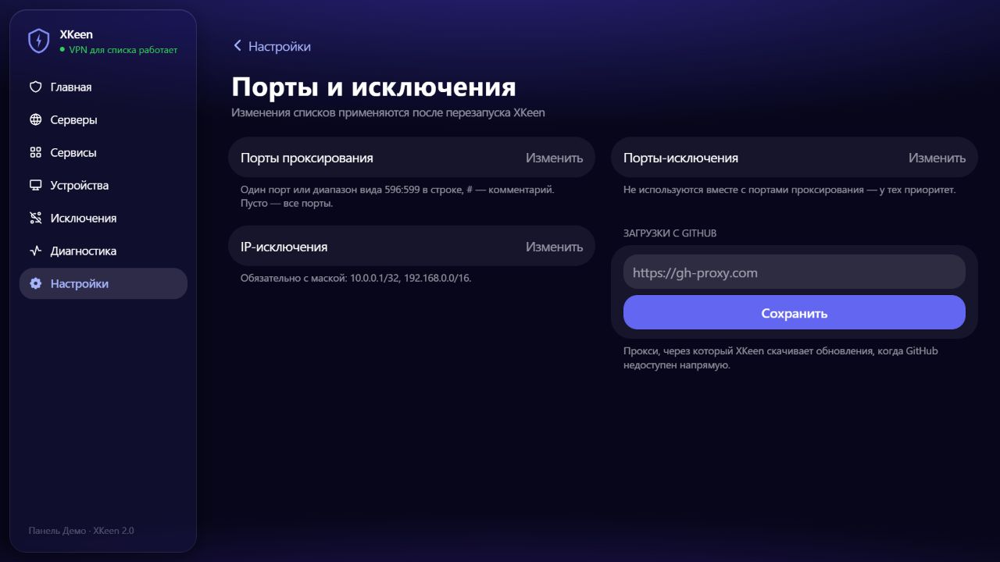

### Перенос настроек

**Настройки → Перенос настроек** сохраняет ваши настройки в один файл и загружает их обратно — на другом роутере или после переустановки.

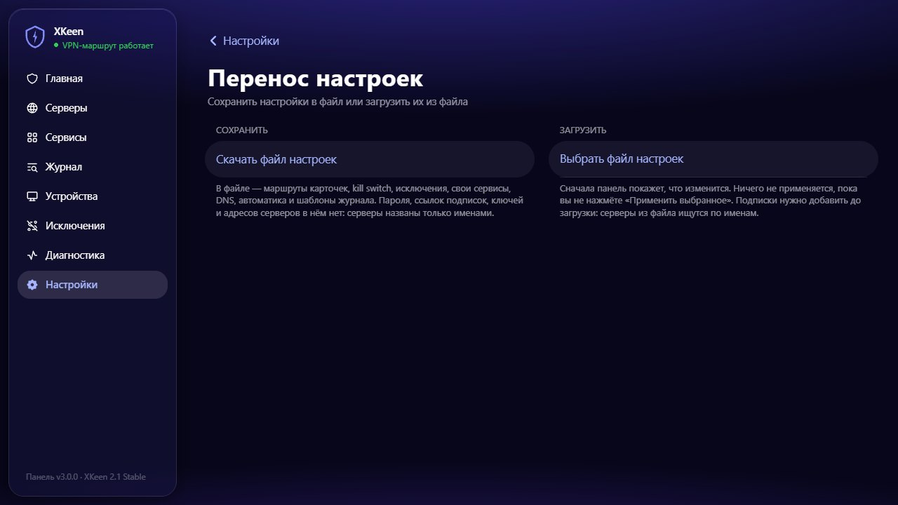

**В файле** — маршруты карточек, kill switch, режим для неопознанного трафика, DNS ядра, свои сервисы, исключения, настройки автоматики и шаблоны журнала. **В файле нет** пароля и кодов входа, ссылок подписок, ключей и адресов серверов: сервер назван только именем подписки и своим именем.

Как загрузить:

1. Сначала добавьте на новом роутере свои подписки: серверы из файла ищутся по именам.
2. Выберите файл. Панель сравнит его с настройками роутера и покажет, что изменится и что применить нельзя и почему — например, «сервера в подписках этого роутера нет».
3. Отметьте нужные разделы и нажмите **Применить выбранное**. Каждое изменение проходит ту же проверку, что и сделанное вручную: непринятое роутер оставляет как было, остальные применяются.

Всё, что ослабляет защиту, — выключение kill switch, режим «только по списку блокировок», маршрут «Напрямую» — собрано в отдельные разделы. Они не выбраны заранее и требуют обычного подтверждения с отсчётом 5 секунд. Исключения из файла только добавляются: ничего из уже настроенного не удаляется.

### Рекомендуемые настройки

**Настройки → Рекомендуемые настройки** показывает только то, что отличается от рекомендованного: что сейчас, что рекомендуется и кнопку **Вернуть**. Кнопка **Вернуть всё** делает это для всего списка.

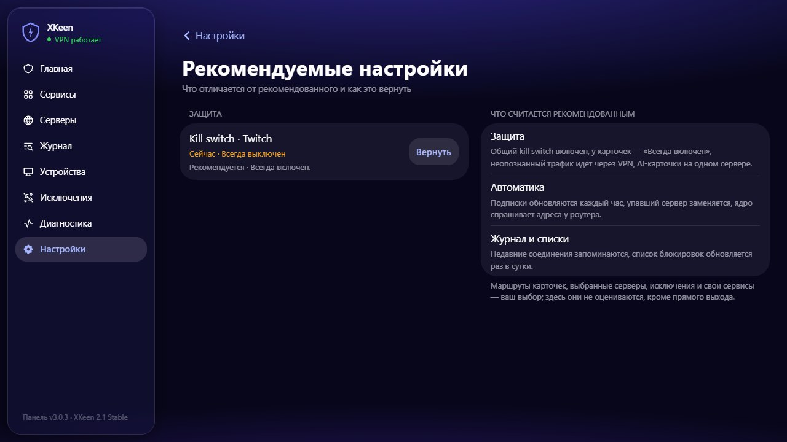

Проверяются общий kill switch и kill switch карточек, режим для неопознанного трафика, прямые маршруты, разные серверы у AI-карточек, DNS ядра, замена упавшего сервера, обновление подписок, недавние соединения в журнале и обновление списка блокировок. Возврат к рекомендованному только усиливает защиту, поэтому подтверждение не требуется. Выбранные серверы, исключения и свои сервисы — ваш выбор и здесь не оцениваются.

### Вход и безопасность

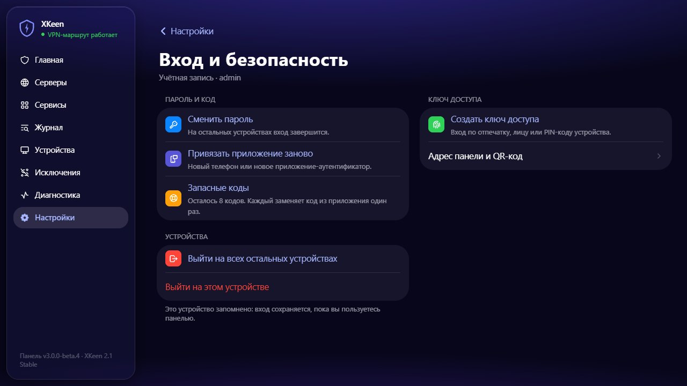

Вход в панель — логин, пароль и **одноразовый код из приложения-аутентификатора**. В **Настройки → Вход и безопасность** собрано всё, что касается учётной записи.

| Действие | Что происходит |
| --- | --- |
| **Сменить пароль** | Новый пароль от 8 символов. На остальных устройствах вход завершится. |
| **Привязать приложение заново** | Для нового телефона или нового приложения. Прежнее приложение работает, пока новое не покажет верный код. Запасные коды после этого нужно создать заново. |
| **Запасные коды** | Десять кодов. Каждый один раз заменяет код из приложения — на случай, если телефон потерян. Панель хранит только их отпечатки и показывает коды один раз: скачайте файл или перепишите. Новые коды отменяют прежние. |
| **Ключ доступа / Face ID** | Вход без пароля и кода по отпечатку, лицу или PIN-коду устройства. Работает только на HTTPS-адресе панели. |
| **Выйти на всех остальных устройствах** | Телефоны и компьютеры, кроме этого, попросят войти заново. |

Перед сменой пароля, новой привязкой приложения и выпуском запасных кодов панель спрашивает текущий пароль и одноразовый код (подойдёт и запасной).

Как панель защищает вход:

- **Паузы после ошибок.** Пять неверных попыток с одного адреса — пауза на минуту, затем на пять и на тридцать минут. Много ошибок с разных адресов подряд ставят на паузу вход для всех на десять минут. Панель пишет об этом в событиях и показывает, сколько осталось ждать.
- **Один ответ на любую ошибку.** «Неверный логин, пароль или одноразовый код» — без подсказки, что именно не подошло. Код проверяется только после верного пароля.
- **Код действует один раз.** Подсмотренный код из приложения повторно не сработает.
- **Запомнить это устройство.** Отметка включена по умолчанию. Она хранит вход 30 дней и продлевает его, пока вы пользуетесь панелью. Без отметки вход заканчивается через сутки. Когда вход закончился, страница входа объясняет почему, а в событиях панели остаётся запись.
- **Копия учётной записи.** Файл с учётной записью записывается целиком и имеет копию: сбой питания в момент записи не оставит панель без входа.

### Адрес панели, HTTPS и Face ID

**Если вам хватает входа с паролем и одноразовым кодом, домашний HTTPS можно пропустить.** HTTPS понадобится для Face ID и системных уведомлений. Без HTTPS пароль идёт по домашней сети открытым текстом — в своей сети это обычно приемлемо, но HTTPS надёжнее.

Когда HTTPS-адрес настроен и отвечает, панель, открытая по обычному адресу, сама переходит на защищённый. Перед переходом браузер проверяет, что защищённый адрес доступен; если он перестал отвечать, вход по обычному адресу остаётся. Адрес с `?plain=1` в конце открывает обычную страницу без перехода.

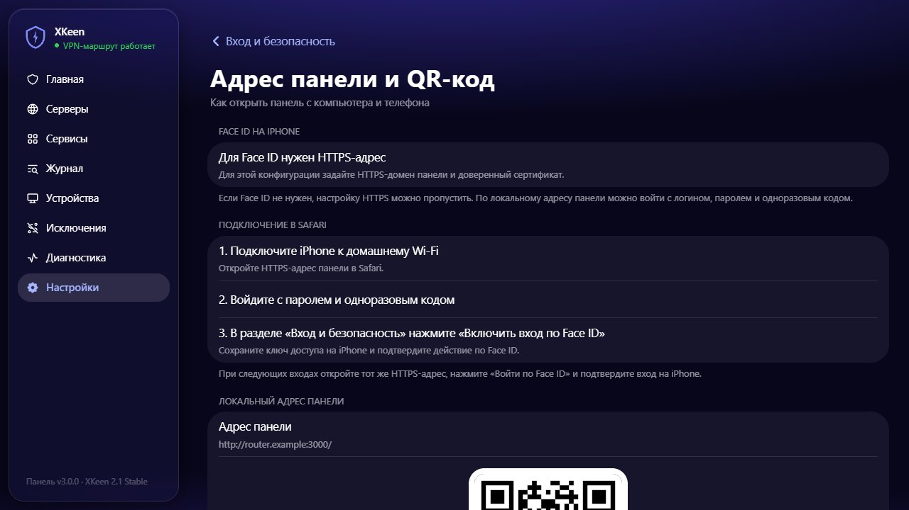

1. Откройте **Настройки → Вход и безопасность → Адрес панели и QR-код → Подготовить адрес для iPhone**. На совместимом роутере панель предложит использовать существующее имя или зарегистрировать новое в CrazeDNS.
2. Нажмите **Проверить адрес и параметры** и прочитайте план. Если у штатного интерфейса роутера разрешён вход из интернета, форма отдельно покажет изменение этого доступа. После подтверждения роутер сам запросит и будет продлевать сертификат. Safari принимает его без установки профиля.
3. Когда появится **HTTPS-адрес готов**, подключите iPhone к домашнему Wi-Fi. Откройте готовую ссылку в Safari или наведите камеру на QR-код панели. Войдите с паролем и одноразовым кодом.
4. Откройте **Настройки → Вход и безопасность → Включить вход по Face ID**, сохраните ключ на iPhone и подтвердите действие. При следующих входах открывайте **тот же HTTPS-адрес** и нажимайте **Войти по Face ID**. Удалить зарегистрированный ключ можно там же.

На экране выше показан вымышленный адрес. Сканируйте QR-код в своей панели. Если помогает агент, попросите: **«Настрой домашний HTTPS через мою панель, объясни изменения удалённого доступа и покажи мой QR-код»**. Имя из публичного сертификата может появиться в открытых журналах сертификатов, поэтому мастер предлагает случайное имя. Ключ доступа сохраняет владелец iPhone. Для быстрого входа с компьютера добавьте ссылку в закладки, на iPhone выберите в Safari **Поделиться → На экран «Домой»**, на Android — пункт установки или добавления на главный экран в меню браузера. [Инструкция для агента](skills/xkeen-router-install/references/panel-https.md)

На компьютере разделы открываются из левого меню. На телефоне в нижней строке пять кнопок: **Главная**, **Сервисы**, **Серверы**, **Журнал** и **Ещё**. За кнопкой **Ещё** — устройства, исключения, диагностика и настройки.

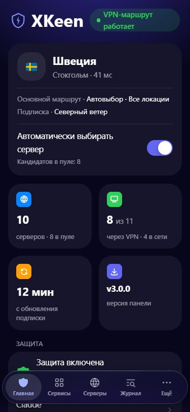

### Уведомления

Настройка действует для конкретного браузера и устройства. Зайдите в панель по HTTPS и откройте **Настройки → Уведомления**. Включите **Системные уведомления** и разрешите их в запросе браузера. На iPhone или iPad с iOS/iPadOS 16.4 и новее сначала добавьте HTTPS-панель на экран «Домой» через Safari и откройте её со значка.

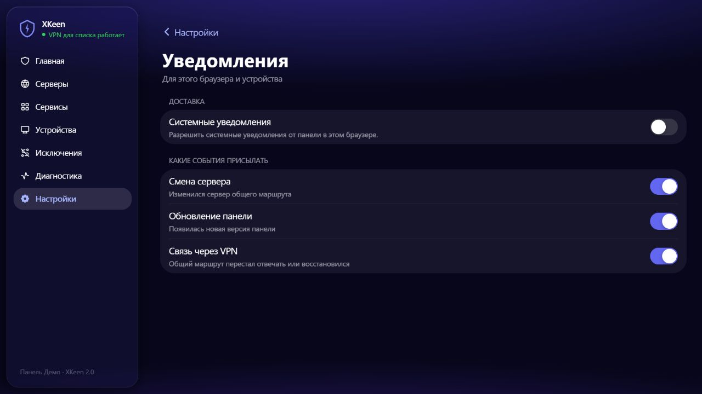

Включите нужные события. **Смена сервера** сообщает о новом сервере для остальных сайтов, **Связь через VPN** — когда VPN не работает дольше 2 минут и когда снова заработал, **Обновление панели** — когда найден новый выпуск. **Срабатывание Kill switch** включается отдельно: уведомляет о наблюдавшемся отказе выбранного VPN при запрещённом прямом выходе, не чаще одного уведомления в минуту. В системное уведомление не передаются адрес сайта и устройство; подробности остаются в журнале панели, и нажатие на уведомление открывает его с событиями kill switch. Нажмите **Отправить проверочное уведомление**. С фоновой доставкой Web Push вкладку можно закрыть. Если браузер предложит **Уведомлять в открытой панели**, для получения событий вкладка должна оставаться открытой. Если доступ уже был запрещён, измените разрешение сайта в настройках браузера.

### Обновление панели и восстановление

**Настройки → О панели и обновление** показывает установленную версию и репозиторий. Переключатель **Обновляться автоматически** включает мастер первой настройки, если вы не сняли его там; при обновлении панели он не меняется. С ним новая версия ставится ночью в указанное на экране время роутера. Если его выключить, панель только сообщает о новой версии — нажмите **Что нового** и **Обновить до…**, панель перезапустится. Кнопка **Проверить сейчас** ищет новую версию сразу.

Если панель неожиданно остановится, она сама запустится снова через несколько секунд, а в событиях появится запись **Панель неожиданно остановилась и сама запустилась снова**. VPN в это время продолжает работать: соединения ведёт ядро роутера, а не панель.

В блоке **Какие версии получать** выбирают между **Стабильные** (по умолчанию) и **Стабильные и бета**. Бета-версии выходят раньше и могут работать с ошибками; без этого выбора они не предлагаются и сами не ставятся.

В блоке **Другая версия** любую версию выбирают из списка — в нём только выпуски с подписью автора. Так возвращаются на более старую версию: панель предупредит, что старая версия может не знать более поздних настроек и защит, и после установки не станет сама возвращать ту, что была новее. Следующую новую версию она поставит как обычно.

Сообщение **Обновление кода панели заблокировано** означает, что установку персональной сборки выполняют отдельно. Подписки серверов по-прежнему обновляются по своему расписанию.

**Выпуск проверяется по подписи автора.** Файлы выпуска лежат на GitHub, и тот, кто получит доступ к репозиторию, мог бы заменить и файл панели, и его контрольную сумму. Поэтому контрольные суммы подписываются ключом, которого на GitHub нет. Панель предлагает и ставит только подписанный выпуск; новый выпуск появляется в панели после того, как автор его подписал. То же проверяет установщик. Своему форку подпись не мешает: открытые ключи лежат в одном файле, их заменяют своими. [Как устроена подпись и что поменять в форке](docs/release-signing.md)

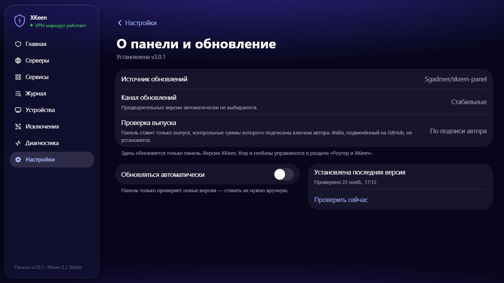

| Что требуется вернуть | Где это сделать |
| --- | --- |
| Более старую версию панели | В **Настройки → О панели и обновление** выберите её в блоке **Другая версия** и нажмите **Установить**. В списке только подписанные версии. |
| Файлы компонента или изменённый параметр | В **Роутер и XKeen → Резервные копии компонентов** выберите доступную копию по компоненту и дате. Нажмите **Восстановить**, затем **Подтвердить восстановление**. Для копии отдельного параметра вернётся его значение. При восстановлении компонентов VPN может кратко перезапуститься. Результат указан в **Последняя операция**. |
| Всю прежнюю установку после переноса | До начала переноса сохраните штатную резервную копию роутера и отдельную копию файлов Entware на компьютере. Для возврата пригодятся обе, включая данные старой панели и её службы. [Порядок миграции и восстановления](docs/migration.md) |

## Сборка и демонстрационный режим

Для локальной сборки используются Go 1.27.1, Node.js 24 и npm. Выполните в корне репозитория

```sh
cd frontend
npm ci
npm run build
cd ..
go test ./...
python3 -m unittest discover -s installer/tests -v
python3 scripts/check-public-source.py --tracked-only
go run . -demo
```

Демонстрационный режим открывает панель на этом компьютере по адресу `http://127.0.0.1:3300` с тестовыми данными. По умолчанию показан вариант с ядром Xray; переменная окружения `XKEEN_DEMO_CORE=mihomo` включает страницы Mihomo: карточки сервисов, kill switch, защиту и журнал. Снимки для этого руководства снимает `scripts/capture-screenshots.mjs` из того же режима: ему нужны собранная демо-программа и любой браузер на Chromium. Рабочие подписки, пароли, HWID, настройки роутера, журналы и резервные копии в релиз не входят. [Проверки проекта](.github/workflows/verify.yml) · [Сборка релиза](.github/workflows/release.yml)

## Авторы

Исходную панель создал Dearonski. Этот форк сопровождает Sgadmer. В разработке панели, установщика, тестов и навыка помогает OpenAI Codex. Его участие указывается в соответствующих коммитах. История исходного проекта сохранена. К коду и зависимостям по-прежнему применяются условия их авторов. [Dearonski/xkeen-panel](https://github.com/Dearonski/xkeen-panel) · [Sgadmer](https://github.com/Sgadmer) · [OpenAI Codex](https://github.com/openai/codex)

Панель использует независимые проекты их авторов. [XKeen](https://github.com/jameszeroX/XKeen) · [Mihomo](https://github.com/MetaCubeX/mihomo) · [Xray-core](https://github.com/XTLS/Xray-core)
